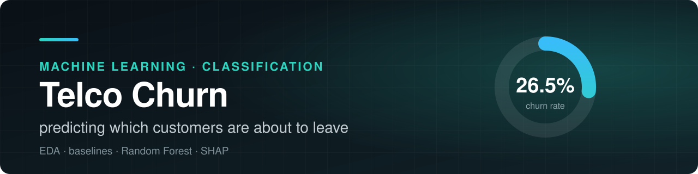
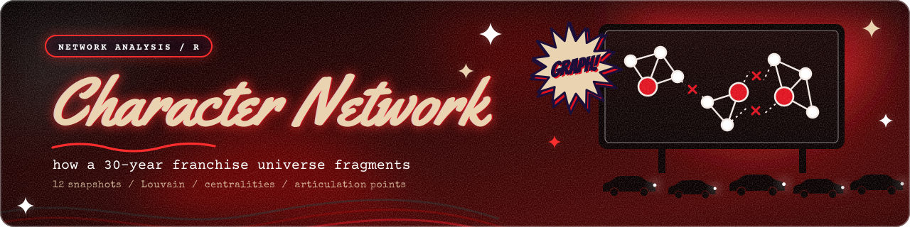
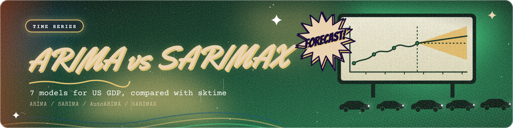
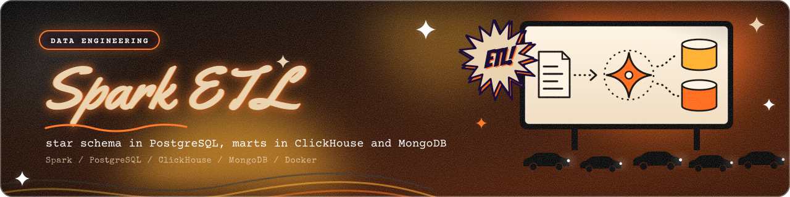
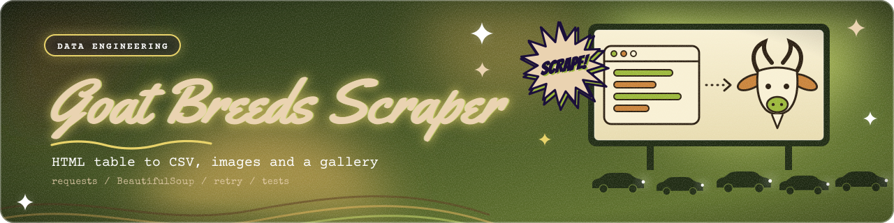
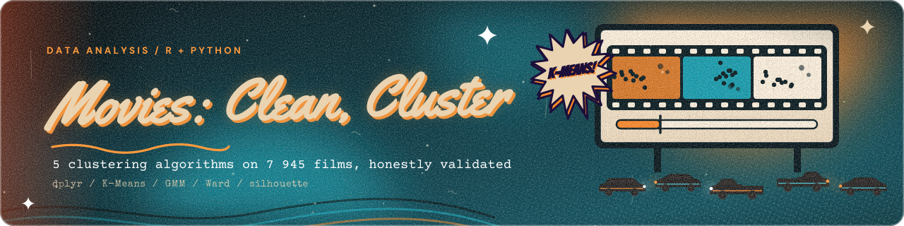

<div align="center">


<br>

[](https://t.me/ollogi)
[](https://drive.google.com/drive/folders/1k8JxVXoA4IyDKNency-2qoXDov1iHgMl)
[](https://itmo.ru)

</div>

---

## Привет, я Олег

Учусь на 4 курсе бизнес-информатики в Университете ИТМО. Я бизнес-продуктовый аналитик: смотрю на продукт через экономику бизнеса, проверяю гипотезы на данных, пишу требования, проектирую API и планирую A/B-тесты. Здесь собраны мои проекты: бизнес-продуктовая аналитика, анализ данных, инженерия данных и машинное обучение.

## Проекты

<table>
  <tr>
    <td width="46%">
      <a href="./tbank-intensive">
        
      </a>
    </td>
    <td>
      <h3><a href="./tbank-intensive">Т-Путешествия: трекер цен с учётом привилегий Т-Премиум</a></h3>
      <p>Интенсив Т-Банка. Как превратить трекер цены из инструмента поиска самого дешёвого билета в инструмент выбора самой выгодной поездки.</p>
      <p>
        
        
        
        
      </p>
      <p><b>Результат на данных:</b> Т-Премиум это 36% аудитории, средний чек выше на 48%, заказов на пользователя 7,53 против 4,38.</p>
    </td>
  </tr>
</table>

<table>
  <tr>
    <td width="46%">
      <a href="./ml/telco-churn-prediction">
        
      </a>
    </td>
    <td>
      <h3><a href="./ml/telco-churn-prediction">Telco Churn: прогноз оттока клиентов</a></h3>
      <p>Полный цикл ML-проекта: пайплайн на scikit-learn, CLI для обучения и скоринга, SHAP, тесты и CI.</p>
      <p>
        
        
        
      </p>
      <p><b>Результат на тесте:</b> находит 81% уходящих клиентов, из всех предупреждений верные 54%. Главный фактор оттока: помесячный контракт.</p>
    </td>
  </tr>
</table>

<table>
  <tr>
    <td width="46%">
      <a href="./data-analysis/resident-evil-network">
        
      </a>
    </td>
    <td>
      <h3><a href="./data-analysis/resident-evil-network">Сеть персонажей Resident Evil: как распадается вселенная</a></h3>
      <p>Сетевой анализ на R: 12 кумулятивных снимков франшизы, сообщества Louvain, центральности. Командный проект, моя часть: подготовка данных и построение сети.</p>
      <p>
        
        
        
      </p>
      <p><b>Результат:</b> сеть растёт с 5 до 51 персонажа, плотность падает с 0,70 до 0,11, сообществ становится 5. Главный хаб: Chris Redfield.</p>
    </td>
  </tr>
</table>

<table>
  <tr>
    <td width="46%">
      <a href="./ml/arima-gdp-forecasting">
        
      </a>
    </td>
    <td>
      <h3><a href="./ml/arima-gdp-forecasting">Семейство ARIMA: прогноз ВВП США на sktime</a></h3>
      <p>Экзаменационный проект ИТМО: сравнение 7 моделей временных рядов, пакет с CLI, тестами и CI.</p>
      <p>
        
        
        
      </p>
      <p><b>Результат:</b> SARIMAX даёт RMSE 1,13 против 2,45 у наивного прогноза; в README разобраны ограничения данных.</p>
    </td>
  </tr>
</table>

<table>
  <tr>
    <td width="46%">
      <a href="./data-engineering/spark-etl-star-schema">
        
      </a>
    </td>
    <td>
      <h3><a href="./data-engineering/spark-etl-star-schema">Spark ETL: звездообразная схема в PostgreSQL, витрины в ClickHouse и MongoDB</a></h3>
      <p>Spark читает плоскую выгрузку, строит измерения и факты в PostgreSQL, считает 6 витрин и пишет их в ClickHouse и MongoDB. Docker Compose с healthcheck, секреты в .env, тесты на синтетических данных.</p>
      <p>
        
        
        
        
        
      </p>
    </td>
  </tr>
</table>

<table>
  <tr>
    <td width="46%">
      <a href="./data-engineering/web-scraping-goat-breeds">
        
      </a>
    </td>
    <td>
      <h3><a href="./data-engineering/web-scraping-goat-breeds">Веб-скрейпинг: породы коз</a></h3>
      <p>Парсер таблицы пород: retry-сессия, поиск столбцов по заголовкам, абсолютные ссылки, загрузка изображений и HTML-галерея. Тесты на фикстуре, CLI.</p>
      <p>
        
        
        
      </p>
    </td>
  </tr>
</table>

<table>
  <tr>
    <td width="46%">
      <a href="./data-analysis/movies-cleaning-clustering">
        
      </a>
    </td>
    <td>
      <h3><a href="./data-analysis/movies-cleaning-clustering">Фильмы: очистка на R и сравнение алгоритмов кластеризации</a></h3>
      <p>Очистка на R, затем K-Means, MiniBatch, GMM и Ward с метриками качества, PCA и профилями кластеров. Вывод честный: структура в данных слабая, и это показано цифрами.</p>
      <p>
        
        
        
      </p>
    </td>
  </tr>
</table>

<table>
  <tr>
    <td width="46%">
      <a href="./ml/health-insurance-rate-modeling">
        
      </a>
    </td>
    <td>
      <h3><a href="./ml/health-insurance-rate-modeling">Тарифы медстрахования: классификация и регрессия без утечки</a></h3>
      <p>Разбор и исправление лабораторной с утечкой цели: разбиение по планам, пороги классов по train, baseline и ансамбль LR + RF. Тесты показывают, как выглядит утечка.</p>
      <p>
        
        
      </p>
    </td>
  </tr>
</table>

| Раздел | О чем |
|---|---|
| [tbank-intensive](./tbank-intensive) | Бизнес-продуктовая и системная аналитика: анализ данных, CustDev, PRD, API, A/B-тест |
| [data-analysis](./data-analysis) | Исследование данных, сетевой анализ, визуализация |
| [data-engineering](./data-engineering) | ETL на Spark, PostgreSQL, ClickHouse, MongoDB, веб-скрейпинг |
| [ml](./ml) | Классификация, временные ряды, оценка и интерпретация моделей |

## Инструменты


## Структура

```text
projects/
├── tbank-intensive/     # проект с интенсива Т-Банка
├── data-engineering/    # ETL и сбор данных
│   ├── spark-etl-star-schema/
│   └── web-scraping-goat-breeds/
├── data-analysis/       # анализ данных
│   ├── resident-evil-network/
│   └── movies-cleaning-clustering/
├── ml/                  # машинное обучение
│   ├── telco-churn-prediction/
│   ├── arima-gdp-forecasting/
│   └── health-insurance-rate-modeling/
├── _template/           # шаблон для нового проекта
└── README.md
```

## Связаться

Лучше всего писать в [Telegram](https://t.me/ollogi). Резюме лежит [здесь](https://drive.google.com/drive/folders/1k8JxVXoA4IyDKNency-2qoXDov1iHgMl).
