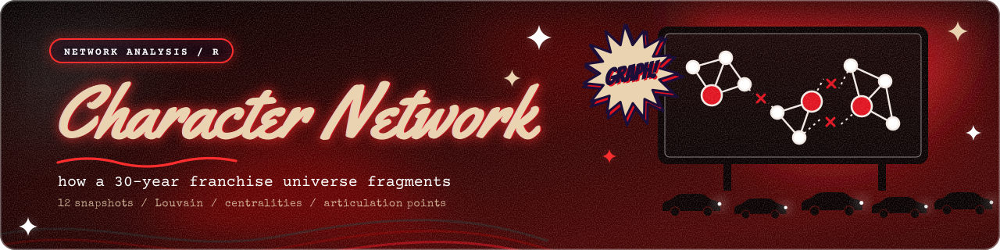

# 📊 Анализ данных

Проекты, где главная цель: найти в данных закономерности и превратить их в понятные выводы.

<table>
  <tr>
    <td width="46%">
      
    </td>
    <td>
      <h3><a href="./resident-evil-network">Сеть персонажей Resident Evil</a></h3>
      
Сетевой анализ на R: 12 кумулятивных снимков, сообщества Louvain, центральности, точки сочленения. Командный проект, моя часть: подготовка данных и построение сети.

      

        
        
        
      

    </td>
  </tr>
</table>

Ещё один проект с анализом данных на R: [tbank-intensive](../tbank-intensive).

[← Все проекты](../)
