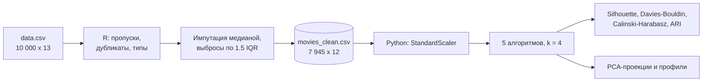
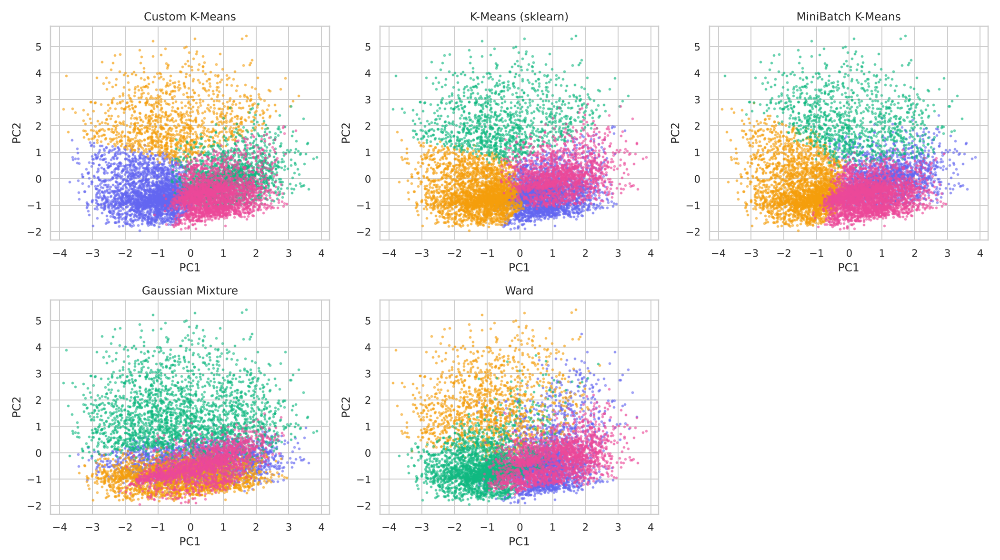

<div align="center">


<br>


</div>

# Фильмы: очистка данных на R и кластеризация на Python

Два шага на одном датасете из 10 000 фильмов (рейтинг, голоса, оценка критиков, сборы, длительность): очистка на R (пропуски, выбросы, дубликаты, импутация) и кластеризация на Python пятью способами с проверкой качества. Учебный проект по курсу «Большие данные и аналитика» (ИТМО), переработанный: к исходным алгоритмам добавлены метрики качества кластеров, подбор числа кластеров и профили групп.

## Пайплайн



## Очистка (R)

Скрипт: [r/01_clean_movies.R](./r/01_clean_movies.R).

| Шаг | Что нашли и сделали |
|---|---|
| Пропуски | `MetaScore` 2026, `Gross` 2915. Ещё 369 пропусков в `Certification` были скрыты пустыми строками, пока `""` не заменили на `NA` |
| Дубликаты | Полностью одинаковых строк нет, повторы в отдельных столбцах естественны |
| Лишние столбцы | `X` (индекс строки) удалён, `Movie.Name` почти уникален (9632 из 10 000) |
| Импутация | Медиана для `MetaScore` и `Gross`, `"Unknown"` для `Certification` |
| Выбросы | Правило 1.5 IQR по всем пяти числовым признакам, осталось 7 945 строк |

## Кластеризация (Python)

Признаки: рейтинг, число голосов, оценка критиков, сборы, длительность. Масштабирование `StandardScaler`, k = 4. Сравниваются собственная реализация K-Means (Lloyd, 10 перезапусков), `KMeans` и `MiniBatchKMeans` из scikit-learn, гауссовы смеси и иерархическая кластеризация Уорда.

| Алгоритм | Silhouette | Davies-Bouldin | Calinski-Harabasz |
|---|---:|---:|---:|
| **Custom K-Means** | **0,223** | 1,363 | 2401 |
| K-Means (sklearn) | 0,223 | 1,361 | 2401 |
| MiniBatch K-Means | 0,218 | 1,344 | 2352 |
| Ward | 0,156 | 1,701 | 1750 |
| Gaussian Mixture | 0,018 | 4,565 | 713 |

Собственная реализация совпадает с эталоном scikit-learn (инерция 20 829 против 20 829, согласие меток ARI 0,99).

<p align="center">
  
</p>

### Что означают кластеры (K-Means, k = 4)

| Кластер | Фильмов | Рейтинг | Голоса | Оценка критиков | Сборы, $ млн | Длительность |
|---|---:|---:|---:|---:|---:|---:|
| 0. Любимые, но негромкие | 2529 | 7,1 | 32,6 тыс. | 68 | 9,8 | 99 |
| 1. Слабые по оценкам | 2637 | 5,9 | 29,3 тыс. | 47 | 15,9 | 100 |
| 2. Популярные и кассовые | 1152 | 6,6 | 111,9 тыс. | 56 | 41,2 | 109 |
| 3. Длинные и высоко оценённые | 1627 | 7,2 | 34,4 тыс. | 64 | 12,8 | 130 |

## Что говорят цифры на самом деле

- **Структура в данных слабая.** Silhouette около 0,22 означает, что кластеры сильно перекрываются. Это видно и на PCA-проекции: чёткого разделения нет, алгоритм режет единое облако на части.
- **k = 4 не выбран данными.** Silhouette при k = 3 выше (0,246 против 0,223), а излома на графике инерции нет ([k_scan_raw.csv](./results/k_scan_raw.csv)). Четыре кластера хорошо читаются как профили, но это интерпретация, а не открытие.
- **Гауссовы смеси здесь не подходят.** Silhouette 0,018 и почти нулевое согласие с остальными методами (ARI около 0,12). Вывод, что все алгоритмы дают «чёткое и устойчивое разбиение», данные не подтверждают. Заметно согласуются лишь K-Means и MiniBatch (ARI 0,76).
- **У 41% строк сборы или оценка критиков равны медиане**, то есть почти наверняка подставлены при импутации. Это искусственно сжимает разброс и тянет объекты к одной точке. Хорошая следующая проверка: кластеризовать только наблюдавшиеся значения.
- **Правило 1.5 IQR вырезало все блокбастеры.** В очищенных данных максимум сборов около 72 млн, а самые популярные фильмы удалены, поэтому выводы относятся только к «обычным» фильмам.
- **Логарифм для `Votes` и `Gross` качество не улучшил** (silhouette 0,215 против 0,223, режим `--log`), хотя гистограммы этих признаков сильно скошены.

## ▶ Запуск

```bash
cd data-analysis/movies-cleaning-clustering
# 1. положите data.csv в ./data (см. data/README.md) и очистите данные
Rscript r/01_clean_movies.R

# 2. кластеризация
pip install -e ".[dev]"
movies-clustering --csv data/movies_clean.csv            # обычное масштабирование
movies-clustering --csv data/movies_clean.csv --log      # с логарифмом Votes и Gross
pytest -q
```

Результаты: таблицы в [results/](./results) (метрики, подбор k, профили кластеров, согласие алгоритмов) и графики в [assets/figures/](./assets/figures). Цифры в этом README получены на реальном `movies_clean.csv`. R-скрипт собран из ячеек исходной работы и в этой среде не запускался (R не установлен), числа очистки взяты из вывода исходной работы.

## Структура

```text
movies-cleaning-clustering/
├── r/01_clean_movies.R            # очистка данных
├── src/movies_clustering/
│   ├── data.py                    # загрузка, масштабирование, флаг импутированных значений
│   ├── algorithms.py              # собственный K-Means и 4 алгоритма scikit-learn
│   ├── evaluate.py                # метрики, подбор k, согласие алгоритмов
│   ├── plots.py                   # PCA, подбор k, профили
│   └── run.py                     # CLI
├── tests/                         # pytest
├── results/                       # таблицы запуска
├── assets/figures/                # графики
└── data/                          # исходные данные (не в git)
```

[← Анализ данных](../) · [← Все проекты](../../)
