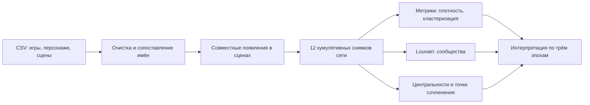
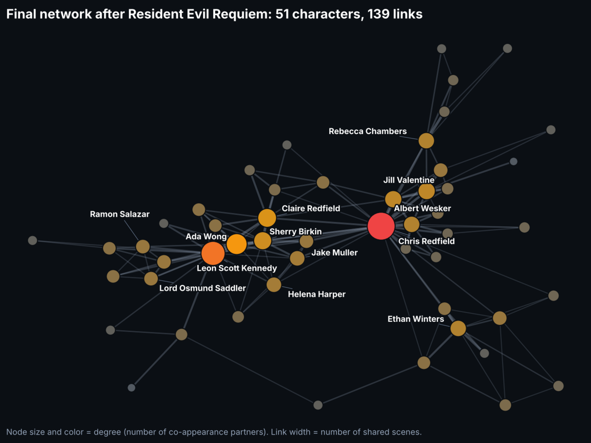
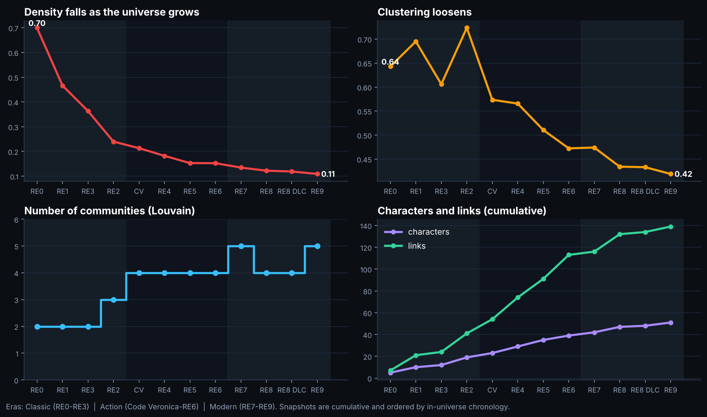
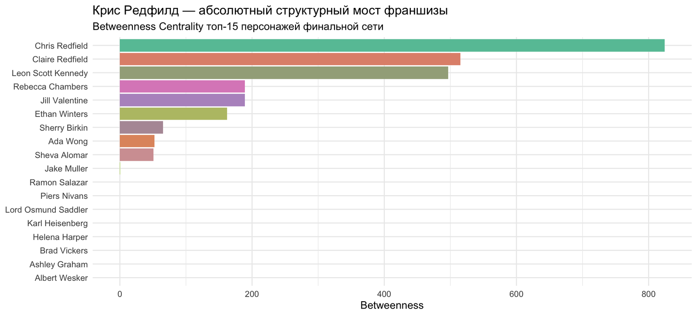
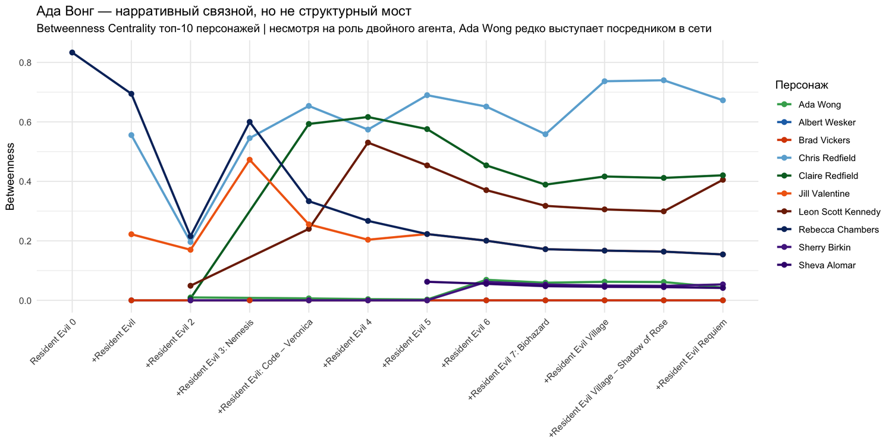
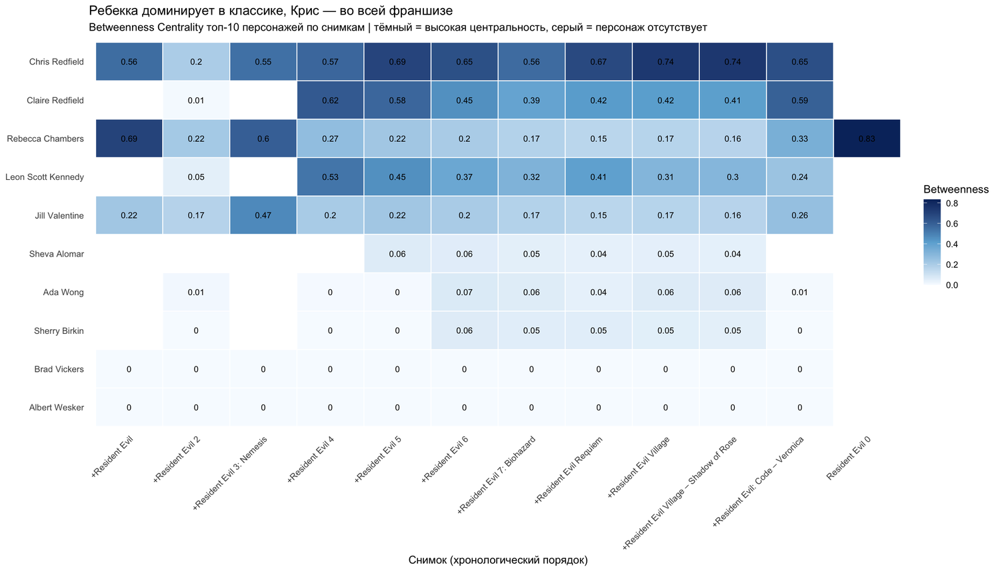
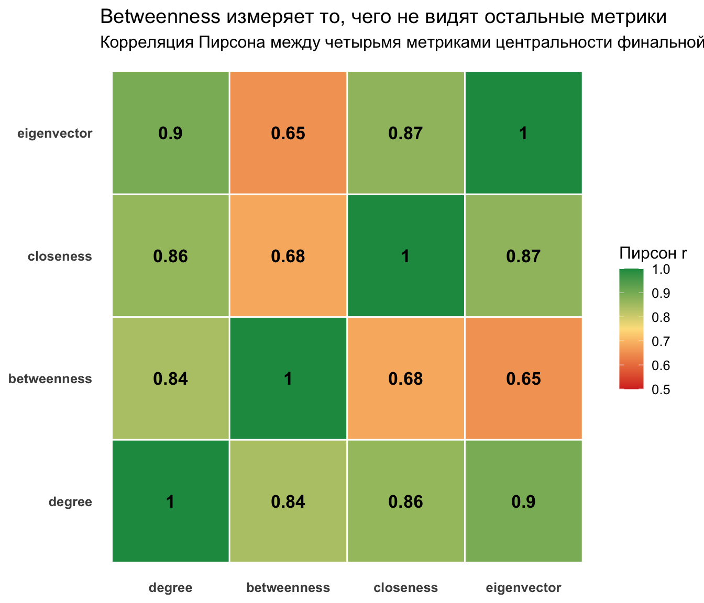

<div align="center">


<br>


</div>

# Как распадается вселенная на 30 лет: сеть персонажей Resident Evil

Исследование эволюции социальной сети персонажей франшизы Resident Evil. Сеть строится по совместным появлениям в сценах и растёт от первой игры (5 персонажей) до Resident Evil Requiem (51 персонаж, 139 связей). Для каждого из 12 кумулятивных снимков считаются метрики сети и находятся сообщества.

** [Читать полный отчёт](https://htmlpreview.github.io/?https://github.com/0lake/projects/blob/main/data-analysis/resident-evil-network/report/resident-evil-network-evolution.html)** (интерактивные графы внутри, файл тяжёлый, около 6 МБ)

> **Про командную работу.** Проект выполнен командой из 4 человек. Моя часть: **подготовка данных и построение сети** (очистка CSV, сеть совместных появлений, 12 кумулятивных снимков, описательные метрики). Анализ эволюции и интерпретация делались совместно.

## Вопрос исследования

Как меняется структура сети персонажей по мере роста франшизы: остаётся ли вселенная связной, кто держит её вместе и появляются ли обособленные сообщества?

## Данные

Датасет [Resident Evil на Kaggle](https://www.kaggle.com/datasets/tommasofacchin/resident-evil/data): игры, персонажи, появления в играх, сцены, взаимодействия. Файлы в репозиторий не входят, инструкция в [data/README.md](./data/README.md).

## Метод



- **Сеть:** вершина это персонаж, ребро означает совместное появление в сцене, вес ребра равен числу общих сцен.
- **Динамика:** снимки накопительные, в порядке выхода игр: RE0, RE1, RE3, RE2, Code Veronica, RE4, RE5, RE6, RE7, RE8 Village, Shadow of Rose, RE9 Requiem.
- **Метрики:** плотность, коэффициент кластеризации, число сообществ (Louvain), degree, betweenness, closeness, eigenvector, точки сочленения.

## Ключевые результаты

| Снимок | Вершин | Рёбер | Плотность | Кластеризация | Сообществ |
|---|---:|---:|---:|---:|---:|
| RE0 | 5 | 7 | 0,70 | 0,643 | 2 |
| RE3 | 12 | 24 | 0,364 | 0,606 | 2 |
| Code Veronica | 23 | 54 | 0,213 | 0,574 | 4 |
| RE5 | 35 | 91 | 0,153 | 0,511 | 4 |
| RE8 Village | 47 | 132 | 0,122 | 0,434 | 4 |
| RE9 Requiem | 51 | 139 | 0,109 | 0,419 | 5 |

- Сеть растёт, но связей на пару персонажей становится всё меньше: плотность падает с 0,70 до 0,11, кластеризация с 0,64 до 0,42. Часть падения чисто механическая, потому что в больших сетях плотность снижается сама по себе.
- Число сообществ растёт с 2 до 5: вселенная распадается на относительно обособленные группы.
- **Chris Redfield** главный хаб: degree 26, betweenness около 824, eigenvector 1,0. **Leon** второй по связям (degree 19, betweenness 496,5), **Claire** с betweenness 515 соединяет группы.
- **Ada Wong** связана с 14 персонажами, но её betweenness всего 52,5. У неё много связей, но мостом между группами она не служит.

<p align="center">
  
</p>

<p align="center">
  
</p>

<details>
<summary><b>Ещё графики: betweenness и корреляции метрик</b></summary>
<br>
<p align="center">
  
  
</p>
<p align="center">
  
  
</p>
</details>

## Структура

```text
resident-evil-network/
├── analysis/
│   ├── 01_build_network.R        # очистка данных, построение сети, снимки
│   └── 02_analyze_evolution.R    # метрики, сообщества, визуализации
├── data/                         # CSV с Kaggle (не в репозитории)
├── report/                       # полный HTML-отчёт
└── assets/                       # баннер и графики
```

## ▶ Как воспроизвести

1. Скачайте CSV по инструкции в [data/README.md](./data/README.md).
2. Установите пакеты: `install.packages(c("dplyr","tidyr","igraph","ggplot2","knitr","kableExtra","reshape2","RColorBrewer","scales","visNetwork"))`.
3. Запустите по порядку из корня проекта: `Rscript analysis/01_build_network.R`, затем `Rscript analysis/02_analyze_evolution.R`.

Скрипты выделены из исходного R Markdown отчёта. Блок `library()` восстановлен по используемым функциям.

## Ограничения

- Ребро означает **совместное появление в сцене**, а не обязательно взаимодействие персонажей.
- Данные собраны фанатами и частично могут быть неполными или неточными.
- Снижение плотности частично вызвано ростом сети, а не только сюжетом.
- Эра и порядок снимков заданы по выходу игр, а не по внутренней хронологии сюжета.

## Авторы

<table>
  <tr>
    <td align="center" width="160">
      <a href="https://github.com/0lake"><br><sub><b>@0lake</b></sub></a>
    </td>
    <td align="center" width="160">
      <a href="https://github.com/althafchik"><br><sub><b>@althafchik</b></sub></a>
    </td>
    <td align="center" width="160">
      <a href="https://github.com/jacoliks"><br><sub><b>@jacoliks</b></sub></a>
    </td>
  </tr>
</table>

[← Анализ данных](../) · [← Все проекты](../../)
