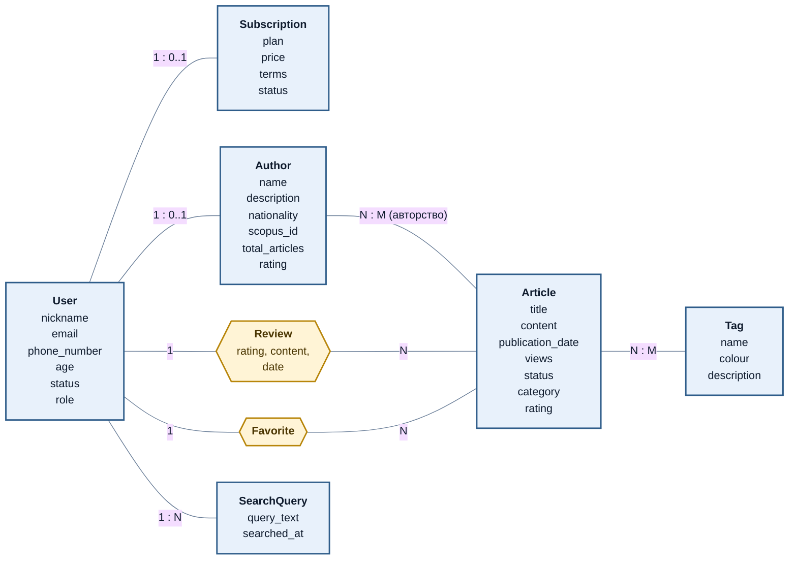
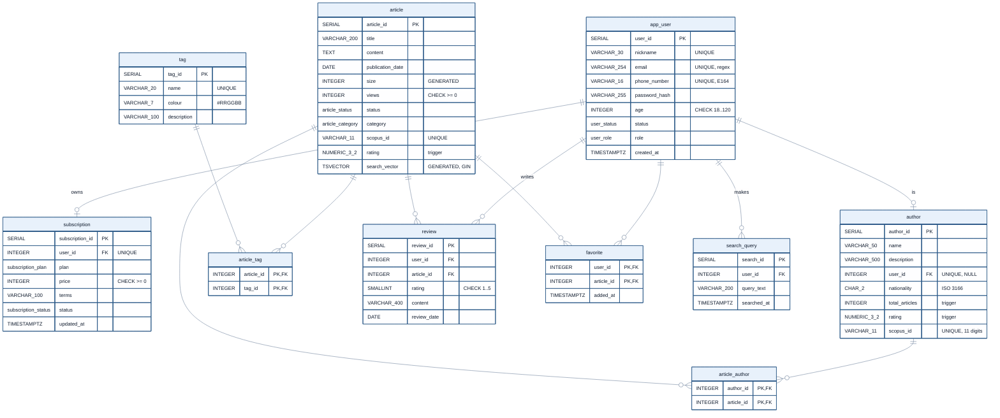

<div align="center">


<br>


</div>

# Article Search: база данных сервиса поиска статей

Реляционная база для сервиса, где можно искать научные, журналистские и другие статьи, оценивать их, оставлять отзывы, вести избранное и подписки. Проект проходит путь от описания предметной области и моделей до работающего полнотекстового поиска на русском языке, триггеров, представлений и аналитики на оконных функциях.

Это второй проект по базам данных в портфолио. Первый, [Cave Schema](../postgresql-cave-schema), про нормализацию и индексы. Здесь акцент на прикладной схеме: поиск, рейтинги, бизнес-правила в базе.

## Содержание

1. [Предметная область](#предметная-область)
2. [Инфологическая модель](#инфологическая-модель)
3. [Даталогическая модель](#даталогическая-модель)
4. [Бизнес-правила в самой базе](#бизнес-правила-в-самой-базе)
5. [Полнотекстовый поиск](#полнотекстовый-поиск)
6. [Представления и аналитика](#представления-и-аналитика)
7. [Как запустить](#как-запустить)
8. [Структура](#структура)

## Предметная область

Сервис хранит статьи и авторов, учитывает просмотры и оценки, считает рейтинг и популярность, показывает выдачу по запросу.

| Бизнес-процесс | Как реализован |
|---|---|
| Регистрация и личный кабинет | `app_user`, проверки email, телефона, возраста; подписка в `subscription` |
| Поиск по ключевым словам, категориям, авторам | `search_articles()` на `tsvector` и GIN, фильтр по категории, теги |
| Избранное, отзыв, оценка | `favorite`, `review` с оценкой от 1 до 5 |
| Загрузка статей авторами | `article`, `article_author`, статусы «черновик», «опубликована», «архив» |
| Обновление рейтинга от действий пользователей | цепочка триггеров: отзыв, статья, автор |
| Анализ популярности | представления и оконные функции |

## Инфологическая модель

Сущности, их атрибуты и связи без привязки к СУБД. Жёлтым выделены связи, у которых есть собственные атрибуты (отзыв несёт оценку и дату).



## Даталогическая модель

Реализация в PostgreSQL: типы данных, ключи, ограничения. Исходная учебная модель при реализации была доработана: теги вынесены в справочник, подписка привязана к пользователю, отзыв получил оценку. Таблица всех изменений с причинами: [`docs/design.md`](docs/design.md).



Исходники диаграмм: [`docs/infological.mmd`](docs/infological.mmd), [`docs/datalogical.mmd`](docs/datalogical.mmd). Знак подчёркивания в типах (`VARCHAR_30`) нужен только синтаксису Mermaid, в SQL это `VARCHAR(30)`.

## Бизнес-правила в самой базе

Правила, которые нельзя нарушить из приложения, обходом или ручным запросом:

| Правило | Механизм |
|---|---|
| Пользователю не меньше 18 лет | `CHECK (age BETWEEN 18 AND 120)` |
| Email, телефон (E.164), Scopus ID (11 цифр) корректны | `CHECK` с регулярными выражениями |
| Бесплатный тариф стоит 0 | `CHECK (plan <> 'бесплатная' OR price = 0)` |
| Опубликованная статья имеет дату публикации | `CHECK` |
| Один отзыв пользователя на статью | `UNIQUE (user_id, article_id)` |
| Отзыв только на опубликованную статью | триггер `review_published_only` |
| Рейтинг статьи равен среднему по отзывам | триггер `review_updates_rating` |
| Рейтинг и число статей автора всегда актуальны | триггеры `article_rating_to_authors`, `article_author_stats` |
| Просрочка оплаты больше месяца деактивирует пользователя | триггер `subscription_user_status` |

Счётчики и рейтинги пересчитываются по источнику, а не увеличиваются на единицу, поэтому не расходятся с данными при удалении, правке и повторной загрузке. Разбор триггеров: [`docs/design.md`](docs/design.md#триггеры).

## Полнотекстовый поиск

```sql
-- фраза, исключение слова, фильтр по категории
SELECT title, category, rating, relevance
FROM search_articles('поиск -нейронные', 'наука');
```

- `tsvector` строится из заголовка (вес A) и текста (вес B), по нему GIN-индекс;
- запрос разбирается как в поисковиках: фразы в кавычках, `OR`, минус для исключения;
- ранжирование `ts_rank_cd`, затем рейтинг и просмотры;
- русская морфология: «цены» находит «цен».

На 100 000 статей запрос по редкому слову: **1,6 мс с GIN-индексом и 37 мс без него**, около 23 раз быстрее ([`benchmark/results.txt`](benchmark/results.txt)). Поиск использует стемминг, а не семантику, и синонимы не находит, подробнее в [`docs/design.md`](docs/design.md#полнотекстовый-поиск).

## Представления и аналитика

| Объект | Назначение |
|---|---|
| `category_rating_view` | средний рейтинг, число статей и просмотры по категориям |
| `active_users_subscriptions` | пользователи онлайн с тарифом и статусом оплаты |
| `popular_articles` | популярность как рейтинг, умноженный на логарифм просмотров |
| `top_authors` (материализованное) | авторы по числу статей и среднему рейтингу |

Оконные функции ([`sql/05_analytics.sql`](sql/05_analytics.sql)): `MAX() OVER` по автору и по категории, отставание статьи от лучшей в категории, `NTILE(4)` по рейтингу, `RANK` и `DENSE_RANK` по просмотрам, накопительная доля трафика, `LAG` по оценкам пользователя.

## Как запустить

Нужен PostgreSQL 14 или новее.

```bash
createdb articles
psql -d articles -v ON_ERROR_STOP=1 -f sql/01_schema.sql
psql -d articles -v ON_ERROR_STOP=1 -f sql/02_functions_triggers.sql
psql -d articles -v ON_ERROR_STOP=1 -f sql/03_views.sql
psql -d articles -v ON_ERROR_STOP=1 -f sql/04_seed.sql
psql -d articles -f sql/05_analytics.sql                  # оконные функции
psql -d articles -v ON_ERROR_STOP=1 -f sql/06_tests.sql   # проверки

# бенчмарк поиска: отдельная база, добавляет 100 000 статей
createdb bench
psql -d bench -f sql/01_schema.sql -f sql/02_functions_triggers.sql -f benchmark/search_benchmark.sql
```

Скрипты идемпотентны. Те же шаги выполняет CI на каждый пуш. Проверки в `sql/06_tests.sql` написаны на `ASSERT`: цепочка триггеров, все ограничения, функции, поиск (морфология, исключения, фильтр, статусы) и представления.

## Структура

```
postgresql-article-search/
├── sql/
│   ├── 01_schema.sql              # типы, таблицы, ограничения, индексы
│   ├── 02_functions_triggers.sql  # функции, поиск, триггеры
│   ├── 03_views.sql               # представления и материализованное
│   ├── 04_seed.sql                # демонстрационные данные
│   ├── 05_analytics.sql           # оконные функции
│   └── 06_tests.sql               # ASSERT-проверки
├── benchmark/
│   ├── search_benchmark.sql       # GIN против Seq Scan на 100 000 статей
│   └── results.txt
├── docs/
│   ├── design.md                  # что изменено в модели и почему
│   ├── infological.mmd
│   └── datalogical.mmd
└── assets/banner.svg
```

[← Data Engineering](../) · [← Все проекты](../../)
