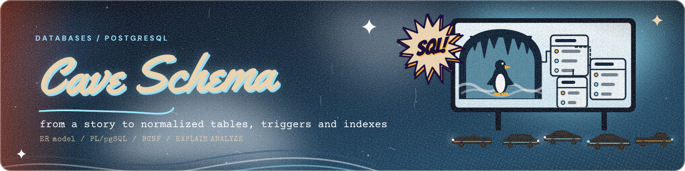
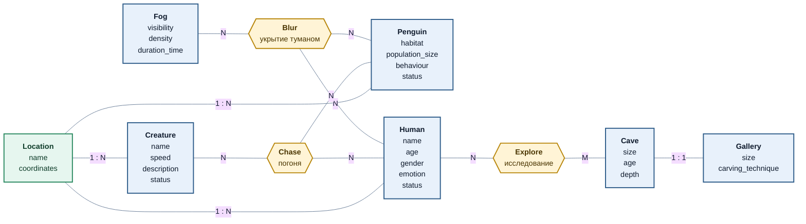
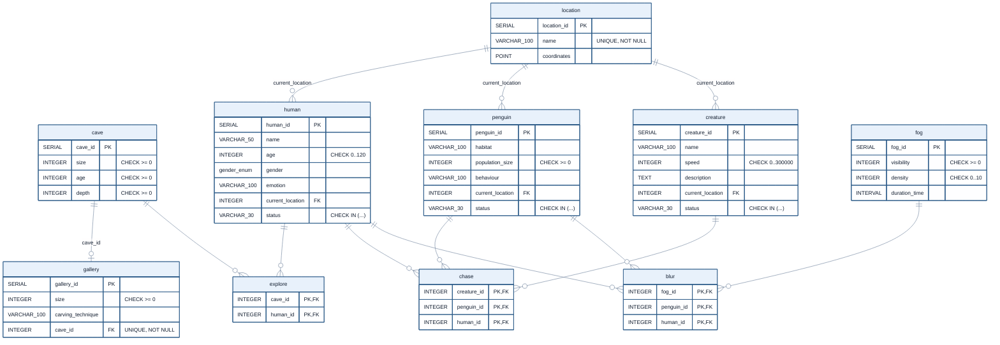

<div align="center">



<br>


</div>

# Cave Schema: проектирование базы данных на PostgreSQL

Полный путь проектирования реляционной базы: художественный текст, из него предметная область, инфологическая модель, даталогическая модель, реализация в PostgreSQL, нормализация до BCNF, триггер на PL/pgSQL и работа с индексами по планам запросов.

Предметная область взята из отрывка о бегстве через галерею в пещеру: люди, пингвины, туман, существо-преследователь. Это намеренно нестандартный домен: в нём есть и справочники, и связи «многие ко многим», и тернарные ассоциации, и состояние, которое меняется от перемещений участников.

## Содержание

1. [Инфологическая модель](#инфологическая-модель)
2. [Даталогическая модель](#даталогическая-модель)
3. [Ограничения целостности](#ограничения-целостности)
4. [Нормализация и денормализация](#нормализация-и-денормализация)
5. [Триггер статусов](#триггер-статусов)
6. [Индексы и планы запросов](#индексы-и-планы-запросов)
7. [Как запустить](#как-запустить)
8. [Структура](#структура)

## Инфологическая модель

Сущности, их атрибуты без привязки к типам СУБД и связи. Жёлтым выделены ассоциации: `Blur` (кого и чем укрыл туман), `Chase` (кто за кем гонится), `Explore` (кто какую пещеру исследует). `Location` выступает характеристикой: в ней находятся люди, пингвины и существа.



## Даталогическая модель

Реализация инфологической модели средствами PostgreSQL: типы данных, первичные и внешние ключи, ограничения. Ассоциации становятся таблицами с составным первичным ключом.



Исходники диаграмм лежат отдельно: [`docs/infological.mmd`](docs/infological.mmd), [`docs/datalogical.mmd`](docs/datalogical.mmd). Типы в диаграмме записаны с подчёркиванием (`VARCHAR_100`) только из-за ограничений синтаксиса Mermaid, в SQL это `VARCHAR(100)`.

## Ограничения целостности

| Ограничение | Где | Зачем |
|---|---|---|
| `CHECK (size >= 0)` и аналоги | `cave`, `gallery`, `penguin`, `fog` | физические величины не бывают отрицательными |
| `CHECK (age BETWEEN 0 AND 120)` | `human` | отсекает опечатки при вводе |
| `CHECK (speed BETWEEN 0 AND 300000)` | `creature` | скорость не выше скорости света, км/с |
| `UNIQUE (cave_id)` | `gallery` | связь пещера-галерея строго 1:1 |
| `UNIQUE (name)` | `location` | место определяется названием |
| `CHECK (status IN (...))` | `human`, `penguin`, `creature` | статус только из допустимых значений |
| Составные `PRIMARY KEY` | `explore`, `chase`, `blur` | одна и та же связь не записывается дважды |
| `ON DELETE CASCADE` | ассоциации, `gallery` | удаление участника не оставляет висячих связей |
| ENUM `gender_enum` | `human` | допустимые значения зафиксированы типом |

## Нормализация и денормализация

Схема проверена по цепочке 1NF, 2NF, 3NF, BCNF с явным выписыванием функциональных зависимостей: все отношения уже в BCNF, декомпозиция не нужна. Для пары «пещера и галерея» вместо слияния таблиц предложено материализованное представление, которое даёт чтение без `JOIN` и не ломает нормальные формы.

Подробности и таблицы зависимостей: [`docs/normalization.md`](docs/normalization.md).

## Триггер статусов

Статус человека, пингвина и существа автоматически отражает, кто рядом с ним:

| Состав в месте | Человек | Пингвин | Существо |
|---|---|---|---|
| Только существо | | | в поисках жертвы |
| Человек и пингвин | в группе с пингвином | в группе с человеком | |
| Существо и кто-то ещё | догнан существом | догнан существом | жертва поймана |
| Один участник | в одиночестве | в одиночестве | |

Ключевая идея: функция `refresh_location_status(location_id)` пересчитывает статусы места по фактическому составу, а триггер вызывает её для нового и для прежнего места участника. Поэтому результат не зависит от порядка перемещений и после ухода существа статусы оставшихся возвращаются в норму. Первая версия триггера из учебной работы этого не делала, разбор ошибок в [`docs/trigger.md`](docs/trigger.md).

```sql
UPDATE human    SET current_location = 3 WHERE name = 'Ворчун';   -- ушёл к пингвинам
UPDATE creature SET current_location = 3;                          -- существо догнало
SELECT name, status FROM human;                                    -- 'догнан существом'
```

Сценарии проверены в [`sql/05_tests.sql`](sql/05_tests.sql) через `ASSERT`: бегство, погоня, расхождение группы, уход существа, удаление участника и срабатывание `CHECK` и `UNIQUE`.

## Индексы и планы запросов

Два запроса с `LEFT JOIN` и фильтрами по фамилии, дате и идентификатору. Для них описаны возможные планы без индексов, выбран оптимальный и сравнён `EXPLAIN ANALYZE` до и после индексов.

| | Без индексов | С индексами |
|---|---|---|
| Запрос 1: две таблицы | 10,5 мс, Seq Scan по 150 000 строк | 1,1 мс, Bitmap Index Scan |
| Запрос 2: три таблицы | 10,8 мс, Seq Scan по `sessions` | 0,045 мс, только Index Scan |

Исходная учебная база недоступна, поэтому таблицы воссозданы по структуре запросов, а данные сгенерированы (20 000 человек, 150 000 сессий, 200 000 записей). Абсолютные числа зависят от машины, важна структура плана. Попутно разобраны две ловушки: условие по правой таблице в `WHERE` превращает `LEFT JOIN` в `INNER JOIN`, а hash-индекс не подходит для составных ключей, поэтому выбран B-tree.

Подробности: [`docs/indexing.md`](docs/indexing.md), планы: [`indexing/plans`](indexing/plans).

## Как запустить

Нужен PostgreSQL 14 или новее.

```bash
createdb cave
psql -d cave -v ON_ERROR_STOP=1 -f sql/01_schema.sql
psql -d cave -v ON_ERROR_STOP=1 -f sql/02_seed.sql
psql -d cave -v ON_ERROR_STOP=1 -f sql/03_status_trigger.sql
psql -d cave -v ON_ERROR_STOP=1 -f sql/04_denormalization.sql
psql -d cave -v ON_ERROR_STOP=1 -f sql/05_tests.sql      # проверки триггера и ограничений

# раздел про индексы (отдельная синтетическая схема)
psql -d cave -f indexing/00_synthetic_schema.sql
psql -d cave -f indexing/01_queries.sql                  # планы до индексов
psql -d cave -f indexing/02_indexes.sql
psql -d cave -f indexing/01_queries.sql                  # планы после индексов
```

Скрипты идемпотентны. Те же шаги выполняет CI на каждый пуш.

## Структура

```
postgresql-cave-schema/
├── sql/
│   ├── 01_schema.sql           # типы, таблицы, ограничения, индексы под FK
│   ├── 02_seed.sql             # тестовые данные
│   ├── 03_status_trigger.sql   # функции и триггеры PL/pgSQL
│   ├── 04_denormalization.sql  # материализованное представление
│   └── 05_tests.sql            # ASSERT-проверки
├── indexing/
│   ├── 00_synthetic_schema.sql
│   ├── 01_queries.sql
│   ├── 02_indexes.sql
│   └── plans/                  # EXPLAIN ANALYZE до и после
├── docs/
│   ├── normalization.md
│   ├── trigger.md
│   ├── indexing.md
│   ├── infological.mmd
│   └── datalogical.mmd
└── assets/banner.svg
```

[← Data Engineering](../) · [← Все проекты](../../)
