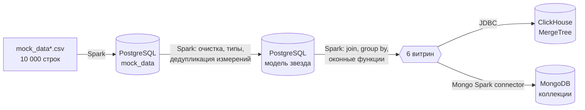
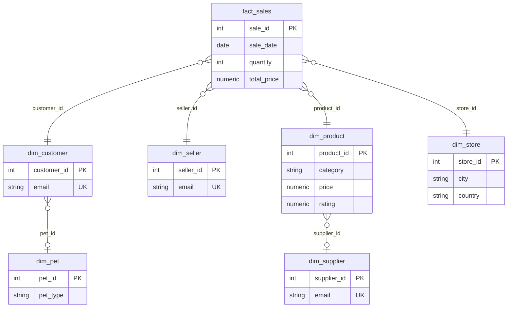

<div align="center">


<br>


</div>

# Spark ETL: звезда в PostgreSQL, витрины в ClickHouse и MongoDB

ETL-пайплайн на Apache Spark. Плоские CSV с продажами зоомагазинов превращаются в нормализованную модель «звезда» в PostgreSQL, а из неё строятся шесть отчётных витрин, которые пишутся сразу в две разные СУБД: колоночную ClickHouse и документную MongoDB. Вся инфраструктура поднимается одной командой `docker compose`.

Учебный проект по курсу «Большие данные и аналитика» (ИТМО), переработанный до воспроизводимого пакета с тестами.

## Архитектура



Зачем три СУБД:

| СУБД | Роль | Почему именно она |
|---|---|---|
| PostgreSQL | Источник правды: модель «звезда» | Ограничения целостности (PK, FK, UNIQUE), транзакции, нормализованное хранение |
| ClickHouse | Аналитические витрины | Колоночное хранение и MergeTree: быстрые агрегаты для BI и дашбордов |
| MongoDB | Те же витрины как документы | Удобная выдача в JSON для API и приложений без схемы |

## Модель данных



Два измерения вынесены в подизмерения (`dim_pet`, `dim_supplier`), поэтому схема ближе к «снежинке» в этих местах. DDL: [sql/postgres/01_star_schema.sql](./sql/postgres/01_star_schema.sql).

## Витрины

| Витрина | Что считает |
|---|---|
| `mart_product_sales` | Топ-10 товаров по выручке: выручка, количество, рейтинг, отзывы |
| `mart_store_sales` | Топ-5 магазинов по выручке и средний чек |
| `mart_time_sales` | Продажи по месяцам: выручка, средний чек, число продаж, рост к прошлому месяцу (`lag`) |
| `mart_customer_sales` | Топ-10 клиентов по сумме покупок, средний чек, число заказов |
| `mart_supplier_sales` | Топ-5 поставщиков по выручке и средняя цена товара |
| `mart_product_quality` | Лучшие и худшие товары по рейтингу, лидеры по отзывам, продажи; плюс корреляция рейтинга и продаж в логе |

DDL витрин для ClickHouse: [sql/clickhouse/01_marts.sql](./sql/clickhouse/01_marts.sql). В MongoDB коллекции создаются при записи.

## ▶ Запуск

```bash
cd data-engineering/spark-etl-star-schema
cp .env.example .env              # задайте свои пароли
# положите mock_data*.csv в ./data (см. data/README.md)

docker compose up -d              # PostgreSQL, ClickHouse, MongoDB
docker compose run --rm etl       # весь пайплайн: staging, star, marts
```

Отдельные этапы: `docker compose run --rm etl python -m etl_star.run --stage star` (или `staging`, `marts`). Опциональный Spark-кластер с UI на `:8080`: `docker compose --profile cluster up -d` и `SPARK_MASTER=spark://spark-master:7077`.

Проверка результата:

```bash
# ClickHouse
docker compose exec clickhouse clickhouse-client -u "$CLICKHOUSE_USER" --password "$CLICKHOUSE_PASSWORD" \
  -q "SELECT year_month, total_revenue, mom_growth_pct FROM lab.mart_time_sales ORDER BY year, month"

# MongoDB
docker compose exec mongo mongosh -u "$MONGO_INITDB_ROOT_USERNAME" -p "$MONGO_INITDB_ROOT_PASSWORD" \
  --authenticationDatabase admin bigdata_lab --eval 'db.mart_store_sales.find().sort({revenue_rank: 1})'
```

Подключиться из DataGrip или DBeaver можно к портам `5434` (PostgreSQL), `8124` (ClickHouse HTTP) и `27018` (MongoDB).

## Тесты

```bash
pip install -e ".[dev]"
pytest -q      # локальный Spark, синтетические данные, базы не нужны
```

Тесты проверяют, что в факт попали все продажи и сумма выручки не изменилась, что измерения дедуплицированы по натуральным ключам, что все внешние ключи разрешаются, что витрины имеют нужный размер и порядок, а помесячная витрина в сумме даёт общую выручку.

## Что важно знать

- **Измерения дедуплицируются по натуральным ключам** (email клиента, продавца и поставщика; полный набор атрибутов для товара и магазина). В первой учебной версии каждая строка CSV порождала свою строку измерения, поэтому один и тот же товар или магазин встречался десятки раз, а топы витрин состояли из дублей.
- **Суррогатные ключи** считаются как `row_number` по натуральному ключу в глобальном окне. Для 10 тысяч строк это нормально, для миллиардов нужны хеш-ключи.
- **Рейтинг в витринах** считается по выручке (в учебной версии ранг назывался `revenue_rank`, но сортировка шла по количеству).
- **ClickHouse** пишется через устаревший драйвер `ru.yandex.clickhouse` (тот, что заработал в исходной работе). Современная замена: `com.clickhouse:clickhouse-jdbc`.
- **MongoDB**: формат `mongodb` и опция `connection.uri` относятся к Spark Connector 10.x.
- **Что проверено:** логика звезды и витрин покрыта тестами на локальном Spark. Запись в живые PostgreSQL, ClickHouse и MongoDB и сам `compose.yaml` в этой среде запустить было нельзя, поэтому первый прогон на вашей машине стоит сделать внимательно.

## Структура

```text
spark-etl-star-schema/
├── compose.yaml            # PostgreSQL, ClickHouse, MongoDB, ETL, опциональный Spark-кластер
├── Dockerfile              # Python + Java + PySpark для ETL-контейнера
├── .env.example            # пароли и имена баз (реальный .env в git не попадает)
├── sql/
│   ├── postgres/01_star_schema.sql
│   └── clickhouse/01_marts.sql
├── src/etl_star/
│   ├── config.py           # настройки из переменных окружения
│   ├── spark_session.py
│   ├── star.py             # CSV-строки -> измерения и факт (чистые функции)
│   ├── marts.py            # 6 витрин (чистые функции)
│   ├── sinks.py            # чтение и запись PostgreSQL, ClickHouse, MongoDB
│   └── run.py              # CLI с этапами
├── tests/                  # pytest, локальный Spark
└── data/                   # сюда кладутся исходные CSV
```

[← Data Engineering](../) · [← Все проекты](../../)
