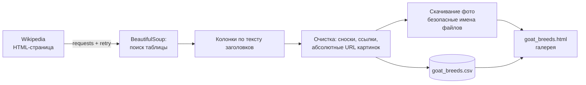

<div align="center">


<br>


</div>

# Веб-скрейпинг: породы коз с Wikipedia

Скрапер, который забирает таблицу [List of goat breeds](https://en.wikipedia.org/wiki/List_of_goat_breeds), скачивает фотографии пород, чистит данные и сохраняет результат в CSV и в готовую HTML-галерею. Учебный проект по курсу «Большие данные и аналитика» (ИТМО), переработанный в пакет с командой запуска и тестами.

## Как это работает



Что здесь сделано аккуратнее, чем «скачал и распарсил»:

- **Колонки определяются по тексту заголовков**, а не по номерам. Если на странице поменяют порядок столбцов или добавят новый, парсер не сломается.
- **Ссылки на картинки приводятся к абсолютным.** Wikipedia отдаёт и `//upload.wikimedia.org/...`, и `/w/images/...`.
- **Сноски `[1]` вырезаются**, составные ячейки (несколько ссылок) склеиваются через запятую.
- **Сеть устроена вежливо:** сессия с повторами и backoff, понятный `User-Agent`, пауза между скачиваниями, уже скачанные файлы пропускаются.
- **Имена файлов безопасные:** название породы превращается в slug, пустое название заменяется запасным.
- **HTML-галерея экранирует данные**, поэтому страница с чужим текстом не может выполнить скрипт.

## ▶ Запуск

```bash
cd data-engineering/web-scraping-goat-breeds
pip install -e ".[dev]"

goat-scraper --out output                # CSV, галерея и фото
goat-scraper --out output --no-images    # только данные
goat-scraper --out output --limit 20     # первые 20 пород
pytest -q
```

Результат: `output/goat_breeds.csv`, `output/goat_breeds.html` и папка `output/images/`.

## Пример результата

| Name | Other names | Origin | Purpose |
|---|---|---|---|
| Anglo-Nubian | Nubian | Great Britain | meat, milk |
| Angora | | Central Anatolia Region | fiber |
| Appenzell | Chèvre d'Appenzell, Appenzellerziege | Switzerland | milk |
| Arapawa | Arapawa Island Goat | Arapaoa Island | meat, milk |

Строки взяты из запуска исходной учебной версии. Фотографии пород остаются под лицензиями Wikimedia Commons, поэтому в репозиторий не добавлены.

## Тесты

Тесты работают без сети на сохранённом фрагменте страницы (`tests/fixtures`): проверяются разбор строк, абсолютные URL, очистка сносок, независимость от порядка колонок, ошибка при отсутствии таблицы, поведение загрузчика картинок (пропуск пустых и уже скачанных) и экранирование в HTML.

Живую страницу в этой среде открыть нельзя, поэтому после изменений на Wikipedia первый запуск стоит проверить глазами. Если таблица изменится слишком сильно, парсер явно упадёт с понятной ошибкой, а не вернёт мусор.

## Структура

```text
web-scraping-goat-breeds/
├── src/goat_scraper/
│   ├── fetch.py     # сессия с повторами, загрузка страницы
│   ├── parse.py     # поиск таблицы и разбор строк
│   ├── images.py    # скачивание фото
│   ├── report.py    # CSV и HTML-галерея
│   └── cli.py       # команда goat-scraper
├── tests/           # pytest без сети
└── output/          # результаты запуска (не в git)
```

[← Data Engineering](../) · [← Все проекты](../../)
