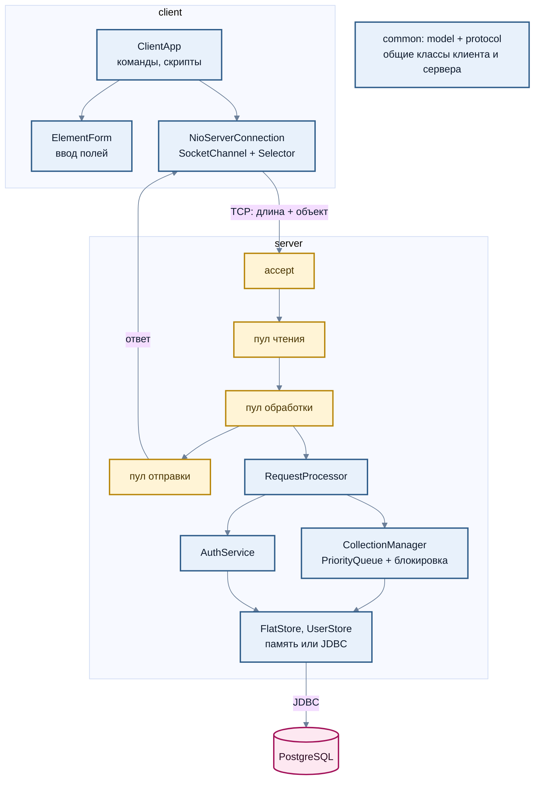
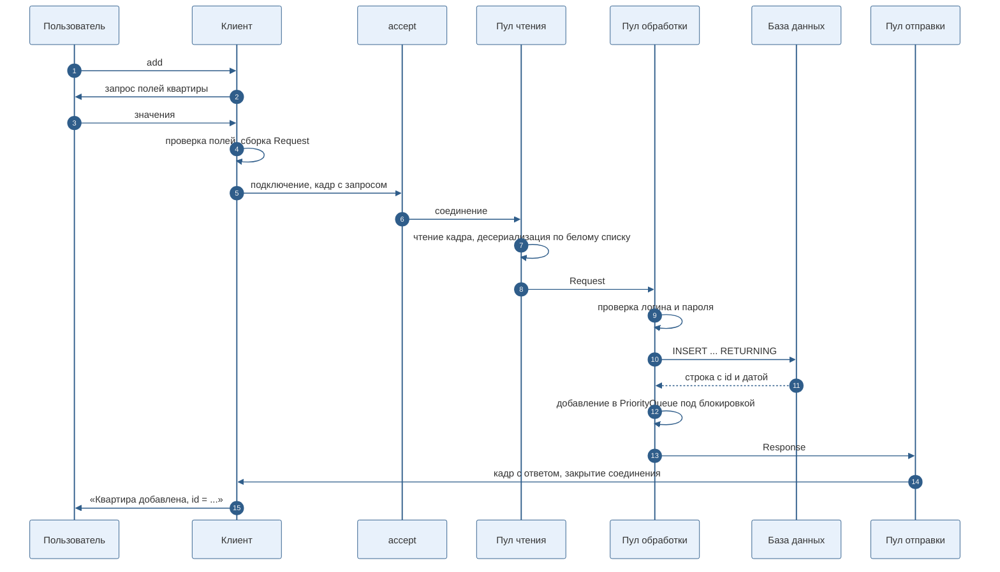
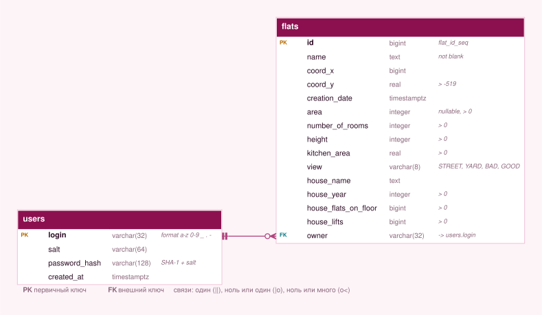
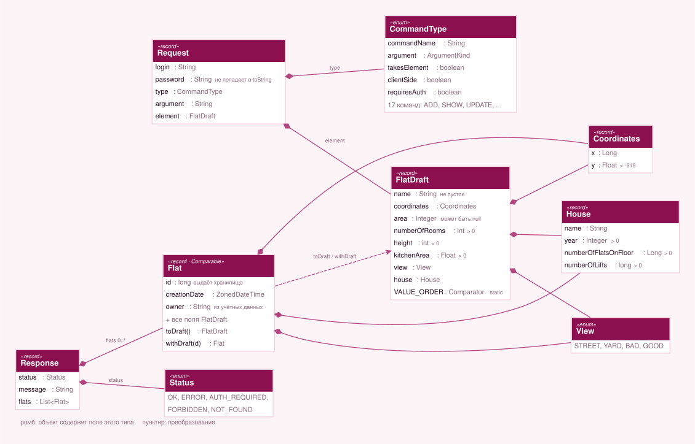

<div align="center">


<br>


</div>

# Flat Manager: клиент-серверное приложение для коллекции квартир

Приложение управляет коллекцией квартир через консоль. Проект вырос из консольной программы с коллекцией в памяти: сначала она была разделена на клиент и сервер по TCP, затем получила хранение в PostgreSQL, регистрацию пользователей и многопоточную обработку запросов. Здесь это один многомодульный проект на Gradle, а не три отдельные программы.

Главные идеи: логика в одном месте, а не в клиенте и сервере вперемешку; права на данные проверяет сервер, а не клиент; хранилище подставляется (память или PostgreSQL), поэтому почти всё тестируется без базы.

## Содержание

1. [Что умеет](#что-умеет)
2. [Архитектура](#архитектура)
3. [Как обрабатывается запрос](#как-обрабатывается-запрос)
4. [База данных](#база-данных)
5. [Модель данных и протокол](#модель-данных-и-протокол)
6. [Команды](#команды)
7. [Протокол](#протокол)
8. [Безопасность и ограничения](#безопасность-и-ограничения)
9. [Тесты](#тесты)
10. [Как запустить](#как-запустить)
11. [Структура](#структура)

## Что умеет

| Возможность | Как реализована |
|---|---|
| Клиент и сервер по TCP | сервер на `ServerSocket`, клиент на неблокирующем `SocketChannel` и `Selector` |
| Регистрация и вход | логин и пароль уходят с каждым запросом, пароль хранится как соль и хеш SHA-1 |
| Хранение в PostgreSQL | JDBC, `PreparedStatement`, последовательность для `id`, ограничения целостности в схеме |
| Многопоточность | пулы потоков для чтения, обработки и отправки, цепочка на `CompletableFuture` |
| Владелец элемента | изменять и удалять можно только свои квартиры, остальные только смотреть |
| Скрипты | команда `execute_script`, защита от рекурсии и от бесконечной вложенности |
| Переподключение | клиент повторяет подключение с нарастающей паузой, пока сервер не поднимется |

## Архитектура

Три модуля. `common` ничего не знает про сеть и базу: только модель и протокол. `server` и `client` зависят от него и друг от друга не зависят.



Что здесь решено осознанно:

- **`RequestProcessor` не знает про сокеты.** Он принимает `Request` и возвращает `Response`, поэтому почти вся логика проверяется обычными тестами, без сети.
- **`FlatStore` и `UserStore` это интерфейсы.** Есть реализация в памяти и реализация на JDBC. Общий набор тестов `StoreContract` прогоняется на обеих, поэтому они ведут себя одинаково.
- **Права проверяются в `CollectionManager`.** Логин владельца берётся из проверенных учётных данных запроса, а не из полей, которые прислал клиент.
- **Описание команд лежит в `CommandType`.** Имя, аргумент, нужен ли элемент, выполняется ли команда на клиенте: клиент строит по этому справку и разбор, сервер строит диспетчеризацию.

## Как обрабатывается запрос



Соединение обслуживает один запрос. Медленный клиент занимает только свой поток чтения и не мешает обработке чужих запросов: этапы разделены пулами и связаны через `CompletableFuture`. У чтения есть тайм-аут 10 секунд, поэтому клиент, который открыл соединение и молчит, не держит поток вечно.

Запись идёт в базу первой и только после успеха попадает в очередь в памяти. Поэтому после ошибки базы память и таблица не расходятся. Просмотры идут параллельно (блокировка чтения), изменения исключают друг друга (блокировка записи).

## База данных

<p align="center"></p>

Схема лежит в [`server/src/main/resources/schema.sql`](server/src/main/resources/schema.sql) и применяется при каждом запуске сервера, поэтому скрипт идемпотентен (`IF NOT EXISTS`).

- Правила предметной области повторены в `CHECK`: положительные числа, `coord_y > -519`, значение `view` из списка, непустое имя, формат логина. Если в базу когда-нибудь запишет кто-то помимо сервера, неверные данные не пройдут.
- `id` выдаёт последовательность `flat_id_seq`, а не клиент и не сервер: два одновременных запроса не получат одинаковый номер.
- `owner` это внешний ключ на `users`.
- Пустая площадь это `NULL`, а не ноль.
- Все запросы выполняются через `PreparedStatement`, строки в SQL не склеиваются.

Модель из дома, вынесенная в плоские столбцы `house_*`, это упрощение: дом не отдельная сущность. Для этой задачи достаточно, но если дома понадобится редактировать отдельно, их нужно вынести в таблицу `houses`.

## Модель данных и протокол

Квартира описана двумя записями: `FlatDraft` это то, что вводит пользователь, `Flat` добавляет то, что назначает сервер (`id`, дата создания, владелец). Из-за этого клиент физически не может прислать чужого владельца или подменить дату: в `Request` едет только `FlatDraft`.

<p align="center"></p>

## Команды

| Команда | Что делает | Где выполняется |
|---|---|---|
| `help` | справка | клиент |
| `register <login>` | регистрация, пароль запрашивается отдельно | сервер |
| `login <login>` | вход | сервер |
| `info` | тип коллекции, дата инициализации, число элементов | сервер |
| `show` | все элементы по названию | сервер |
| `add {element}` | добавить квартиру | сервер |
| `update <id> {element}` | заменить свою квартиру | сервер |
| `remove_by_id <id>` | удалить свою квартиру | сервер |
| `clear` | удалить все свои квартиры | сервер |
| `execute_script <file>` | выполнить скрипт | клиент |
| `add_if_min {element}` | добавить, если меньше наименьшего | сервер |
| `remove_greater {element}` | удалить свои, что больше заданной | сервер |
| `remove_lower {element}` | удалить свои, что меньше заданной | сервер |
| `sum_of_height` | сумма высот потолков | сервер |
| `group_counting_by_house` | число квартир в каждом доме | сервер |
| `filter_starts_with_name <text>` | квартиры, название которых начинается с подстроки | сервер |
| `exit` | завершить клиент | клиент |

Порядок квартир задан в `FlatDraft.VALUE_ORDER`: площадь (пустая считается нулём), число комнат, название. При равенстве всех трёх `Flat` сравнивается по `id`, чтобы порядок был полным.

В интерактивном режиме неверное поле запрашивается заново. В скрипте ошибка прерывает команду: скрипт с опечаткой не должен молча создать неправильные данные. Демонстрационный скрипт: [`scripts/demo.txt`](scripts/demo.txt).

## Протокол

Сообщение это кадр: четыре байта длины (big-endian) и сериализованный Java-объект `Request` или `Response`. Описание полей и ограничений в [`docs/protocol.md`](docs/protocol.md).

Десериализация данных из сети это известный источник уязвимостей, поэтому в `Wire` она ограничена:

- белый список классов (`flats.common.**`, часть `java.lang`, `ArrayList`, `java.time`), всё остальное отклоняется;
- ограничения глубины графа, числа ссылок и размера сообщения;
- проверка, что пришёл ожидаемый тип;
- запрос не больше 64 КБ, ответ не больше 32 МБ.

## Безопасность и ограничения

Часть решений продиктована условием учебного задания, и они слабее, чем нужны настоящему сервису. Я оставил их заметными, а не спрятал.

| Что | Как сейчас | Что нужно для реального сервиса |
|---|---|---|
| Хеш пароля | соль и SHA-1 | bcrypt, scrypt или Argon2 с настраиваемой стоимостью. Алгоритм изолирован в `PasswordHasher`, замена не затрагивает остальной код |
| Канал | обычный TCP, пароль уходит с каждым запросом открытым текстом | TLS, а лучше сессионный токен вместо повторной отправки пароля |
| Перебор паролей | нет ограничения числа попыток | задержки и блокировка по логину и адресу |
| Несколько серверов | коллекция кэшируется в памяти одного процесса, второй экземпляр не увидит чужих изменений | убрать кэш или добавить инвалидацию |
| Соединения с базой | новое соединение на операцию | пул соединений (например, HikariCP) |
| Формат сообщений | Java-сериализация | JSON или Protobuf, не привязанные к классам JVM |
| Вход несуществующего пользователя | отвечает чуть быстрее, чем неверный пароль | выровнять время ответа |

## Тесты

58 тестов на JUnit 4.

| Что проверяется | Где |
|---|---|
| Проверки полей модели, порядок сортировки | `common`, `ModelTest` |
| Кадры, белый список классов, лимиты, скрытие пароля в `toString` | `common`, `WireTest` |
| Хеширование, регистрация, неверные пароли, попытка внедрения в логин | `server`, `AuthTest` |
| Все команды, права владельца, граничные случаи | `server`, `CollectionTest` |
| Параллельные добавления и удаления | `server`, `ConcurrencyTest` |
| Одинаковое поведение хранилищ в памяти и в PostgreSQL | `server`, `StoreContract` |
| Клиент и сервер на настоящем сокете: вход, форма, скрипты, рекурсия, недоступный сервер, мусор из сети, 100 параллельных запросов | `client`, `EndToEndTest` |

Тесты хранилища на PostgreSQL запускаются, когда задана переменная `TEST_DB_URL`; иначе они пропускаются. В CI база поднимается сервисом, поэтому там выполняются все 58.

Схема и SQL-запросы дополнительно проверены вручную в `psql` на PostgreSQL 16: идемпотентность скрипта, `RETURNING`, `= ANY(?)`, срабатывание каждого вида ограничений.

## Как запустить

Нужен JDK 21. Gradle ставить не нужно, есть wrapper.

```bash
# 1. База данных (можно пропустить: тогда данные хранятся в памяти)
docker compose up -d

# 2. Сервер
export FLATS_DB_URL=jdbc:postgresql://localhost:5432/flats
export FLATS_DB_USER=flats
export FLATS_DB_PASSWORD=flats
./gradlew :server:run

# 3. Клиент, в другом терминале
./gradlew :client:run --console=plain

# Тесты
./gradlew test
TEST_DB_URL=jdbc:postgresql://localhost:5432/flats ./gradlew test   # вместе с PostgreSQL
```

Настройки сервера берутся из переменных окружения:

| Переменная | По умолчанию | Назначение |
|---|---|---|
| `FLATS_PORT` | `5555` | порт TCP |
| `FLATS_DB_URL` | пусто | JDBC URL; если не задан, используется хранилище в памяти |
| `FLATS_DB_USER` | `flats` | пользователь базы |
| `FLATS_DB_PASSWORD` | пусто | пароль базы |
| `FLATS_READ_THREADS` | число ядер | размер пула чтения |
| `FLATS_WORK_THREADS` | число ядер | размер пула обработки |

Клиент принимает адрес и порт аргументами: `./gradlew :client:run --console=plain --args="localhost 5555"`.

Пример сессии:

```text
> register oleg
Пароль:
Пользователь oleg зарегистрирован
> execute_script scripts/demo.txt
Квартира добавлена, id = 1
Квартира добавлена, id = 2
> sum_of_height
Сумма высот: 6
> remove_by_id 2
Квартира 2 удалена
> remove_by_id 2
Квартира с id 2 не найдена
```

## Структура

```
flat-collection-manager/
├── common/                модель и протокол
│   └── src/main/java/flats/common/
│       ├── model/         Flat, FlatDraft, House, Coordinates, View, проверки
│       └── protocol/      CommandType, Request, Response, Status, Wire
├── server/
│   ├── src/main/java/flats/server/
│   │   ├── auth/          PasswordHasher, AuthService
│   │   ├── collection/    CollectionManager
│   │   ├── command/       RequestProcessor
│   │   ├── net/           Server (пулы потоков, конвейер)
│   │   └── store/         интерфейсы, memory/, jdbc/
│   └── src/main/resources/schema.sql
├── client/
│   └── src/main/java/flats/client/
│       ├── form/          ElementForm
│       ├── io/            консоль и файл скрипта
│       └── net/           NioServerConnection
├── scripts/demo.txt       демонстрационный скрипт
├── docs/                  protocol.md, схемы (er.svg, model.svg) и их исходник er.mmd
├── docker-compose.yml     PostgreSQL для запуска
└── build.gradle, settings.gradle, gradlew
```

[← Java](../) · [← Все проекты](../../)
