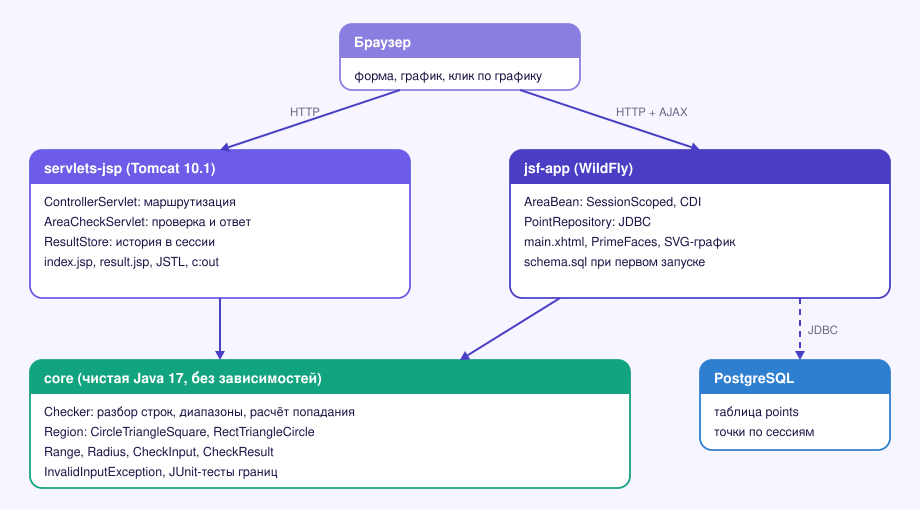
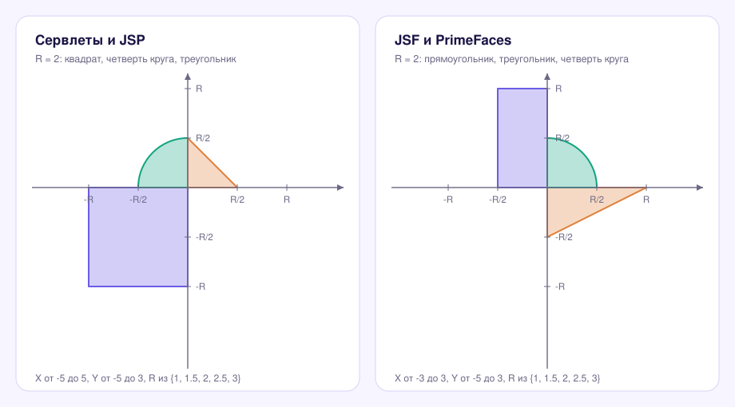

<div align="center">


<br>


</div>

# Area Checker: проверка точки в области на двух веб-стеках

Пользователь задаёт точку и размер области R, а приложение отвечает, попала ли точка в область, рисует график и хранит историю проверок. Задача одна, а реализаций две: классическая на сервлетах и JSP и более «корпоративная» на JSF, PrimeFaces, CDI и PostgreSQL. Обе лежат в одном проекте и используют общее ядро, поэтому видно, где заканчивается логика и начинается веб.

Главная идея: геометрия, разбор и проверка ввода написаны на чистой Java без зависимостей и покрыты тестами на границах фигур. Сервлеты и JSF остаются тонкой оболочкой над ней.

## Содержание

1. [Что умеет](#что-умеет)
2. [Архитектура](#архитектура)
3. [Области](#области)
4. [Как это работает](#как-это-работает)
5. [База данных](#база-данных)
6. [Что исправлено по сравнению с исходными версиями](#что-исправлено-по-сравнению-с-исходными-версиями)
7. [Тесты](#тесты)
8. [Как запустить](#как-запустить)
9. [Структура](#структура)
10. [Ограничения](#ограничения)

## Что умеет

| Возможность | Сервлеты и JSP | JSF и PrimeFaces |
|---|---|---|
| Ввод | X текстом, Y и R кнопками | X и Y текстом, R переключателем |
| График | `canvas`, перерисовывается при смене R | встроенный SVG, перерисовывается при смене R |
| Клик по графику | ставит точку и отправляет форму | ставит точку и отправляет форму через AJAX |
| История | в сессии, до 100 записей | в PostgreSQL, последние 10 для каждой сессии |
| Обновление страницы | отдельная страница результата | без перезагрузки: таблица и график обновляются по AJAX |
| Ошибки ввода | сразу все найденные проблемы, статус 400 | сообщения в `p:messages` |

## Архитектура

Три модуля. `core` ничего не знает ни про сервлеты, ни про JSF, ни про базу. Оба веб-модуля зависят от него и друг от друга не зависят.

<p align="center">
  
</p>

Что решено осознанно:

- **Ядро без зависимостей.** `Checker` принимает строки и возвращает результат либо исключение со списком всех проблем. Поэтому границы фигур и валидация проверяются обычными тестами без контейнера.
- **Область это интерфейс.** `Region` описывает фигуру и допустимые диапазоны, а две реализации (`CircleTriangleSquare`, `RectTriangleCircle`) подставляются в разные модули.
- **Контроллер ничего не считает.** `ControllerServlet` только маршрутизирует, проверку делает `AreaCheckServlet`, показ делает JSP.
- **Конфигурация снаружи.** Параметры базы читаются из переменных окружения, в коде и репозитории паролей нет.

## Области

Граница входит в область. Все размеры зависят от R.

<p align="center">
  
</p>

## Как это работает

**Сервлеты.** Запрос приходит на `/controller`. Если в нём есть `x`, `y` или `r`, контроллер передаёт его на `/check`, иначе показывает главную страницу. `AreaCheckServlet` вызывает `Checker`, кладёт результат в `ResultStore` сессии и показывает страницу результата. Вывод идёт через `<c:out>`, поэтому введённый текст не превращается в разметку. Прямое обращение к `/check` перенаправляется на контроллер.

**JSF.** `AreaBean` живёт в сессии и хранит значения полей. Кнопка «Проверить» вызывает `check()`, который сохраняет результат через `PointRepository`. После этого сервер отправляет браузеру скрипт `Area.load([...])` с историей, и график обновляется без перезагрузки. Клик по SVG переводится в координаты через `getScreenCTM`, поэтому точка попадает в нужное место при любом масштабе страницы.

## База данных

Только в JSF-версии. Таблица создаётся скриптом `schema.sql` при первом запуске, повторный запуск безопасен.

| Колонка | Тип | Назначение |
|---|---|---|
| `id` | `BIGSERIAL`, PK | порядок проверок |
| `session_id` | `VARCHAR(64)` | у каждой сессии своя история |
| `x`, `y` | `DOUBLE PRECISION` | координаты точки |
| `r` | `DOUBLE PRECISION`, `CHECK (r > 0)` | размер области |
| `hit` | `BOOLEAN` | попала ли точка |
| `checked_at` | `TIMESTAMPTZ` | время проверки |

Индекс `(session_id, id DESC)` ускоряет выборку последних записей. Все запросы идут через `PreparedStatement`.

## Что исправлено по сравнению с исходными версиями

| Было | Стало |
|---|---|
| Пароль к базе данных прямо в коде | URL, пользователь и пароль из переменных окружения |
| Текст ошибки выводился в JSP без экранирования | вывод через `<c:out>` |
| Y принимался любым числом, хотя в интерфейсе только целые значения | диапазон и набор значений проверяются в одном месте на сервере |
| Дублирующиеся сопоставления сервлетов и неиспользуемые наборы допустимых значений | аннотации `@WebServlet`, один источник допустимых значений |
| История общая для всех посетителей | история привязана к сессии |
| В JSF-графике дуга четверти круга не совпадала с проверкой на сервере | график рисуется из тех же формул, что и проверка |
| Проверки на клиенте и на сервере расходились | сервер проверяет всё, клиент только подсказывает |
| В репозитории лежали собранные WAR-файлы, каталоги IDE и служебные файлы | сборка и `.gitignore` |

## Тесты

27 тестов ядра проверяют каждую фигуру на границах и вершинах, масштабирование по R, отклонение мусора (`NaN`, бесконечность, слишком длинное число, запятая как разделитель), все проблемы в одном исключении и время результата на фиксированных часах. Ещё 3 теста проверяют сериализацию истории для графика независимо от локали. 4 интеграционных теста работают с PostgreSQL и запускаются при заданном `TEST_DB_URL`, иначе пропускаются.

```bash
./gradlew test
```

В CI поднимается живой PostgreSQL, а оба WAR-файла собираются и выкладываются как артефакты.

## Как запустить

Нужны JDK 17 и Gradle (в проекте есть wrapper).

```bash
./gradlew build
```

Сервлеты и JSP, Tomcat 10.1 или новее:

```bash
cp servlets-jsp/build/libs/area-servlets.war $CATALINA_HOME/webapps/
# откройте http://localhost:8080/area-servlets/
```

JSF, WildFly 27 или новее и PostgreSQL:

```bash
docker compose up -d                       # PostgreSQL на порту 5432
export AREA_DB_URL=jdbc:postgresql://localhost:5432/area
export AREA_DB_USER=area
export AREA_DB_PASSWORD=area
cp jsf-app/build/libs/area-jsf.war $WILDFLY_HOME/standalone/deployments/
# откройте http://localhost:8080/area-jsf/
```

Пароль в `docker-compose.yml` по умолчанию `area`, для локального запуска этого достаточно. Свой пароль задаётся переменной `AREA_DB_PASSWORD` до `docker compose up`.

## Структура

```
web-area-checker/
├── core/                      # логика без зависимостей
│   └── src/{main,test}/java/area/
│       ├── Checker.java       # разбор, проверка, попадание
│       ├── Region.java        # область: форма и диапазоны
│       ├── CircleTriangleSquare.java
│       ├── RectTriangleCircle.java
│       ├── Range.java  Radius.java
│       └── CheckInput.java  CheckResult.java  InvalidInputException.java
├── servlets-jsp/              # WAR для Tomcat
│   └── src/main/{java/web,webapp}
├── jsf-app/                   # WAR для WildFly
│   └── src/main/{java/web,resources/db,webapp}
├── docs/                      # схемы
├── docker-compose.yml         # PostgreSQL для JSF-версии
└── .env.example
```

## Ограничения

- Веб-слои проверялись компиляцией и разбором разметки, а полная сборка и запуск на Tomcat и WildFly выполняются в CI и на сервере приложений. Ядро и SQL проверены тестами и на живой базе.
- Страницы JSF восстановлены по описанию интерфейса, в исходном архиве файлов представлений не было.
- На каждый запрос открывается отдельное соединение с базой. Для учебной нагрузки этого достаточно, для реальной нужен пул соединений.
- Идентификатор сессии хранится в базе как есть, для учебного проекта это допустимо, для рабочего лучше хранить хеш.
- Политика безопасности ограничена базовой: нет защиты от CSRF и ограничения частоты запросов.

[← Все проекты на Java](../)
