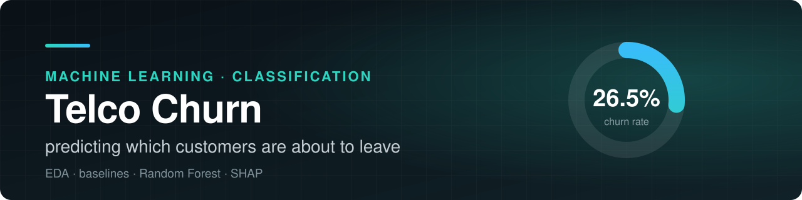

# 🤖 Машинное обучение

Проекты по построению и оценке моделей: от подготовки признаков до интерпретации результатов.

## Проекты

<table>
  <tr>
    <td width="46%">
      
    </td>
    <td>
      <h3><a href="./telco-churn-prediction">Telco Churn: прогноз оттока клиентов</a></h3>
      
Бинарная классификация на 7043 клиентах: EDA, бейзлайны, Random Forest с подбором гиперпараметров, интерпретация через permutation importance и SHAP.

      

        
        
        
      

      
<b>Лучший Recall:</b> 0,79 у дерева решений при Accuracy 0,74.

    </td>
  </tr>
</table>

[← Все проекты](../)
