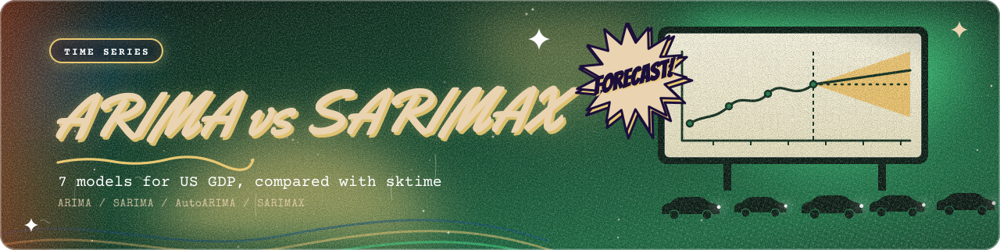
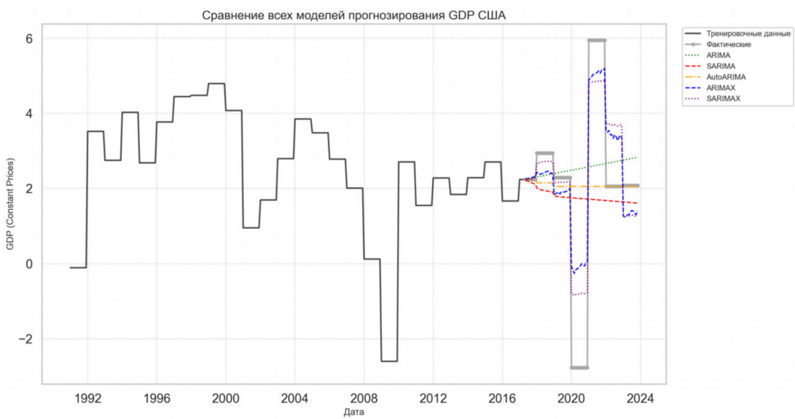
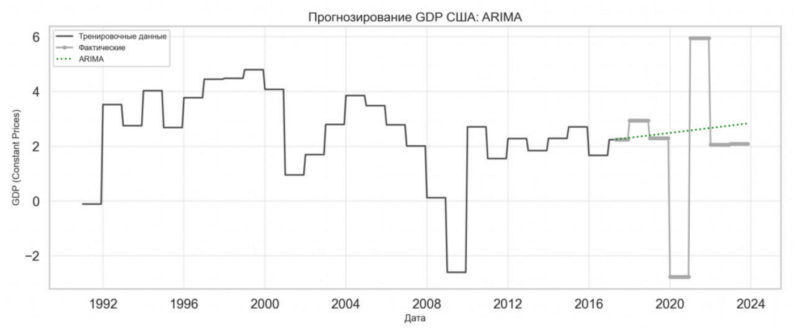
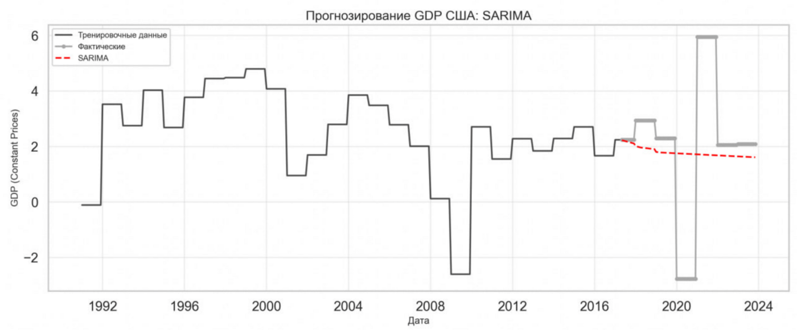
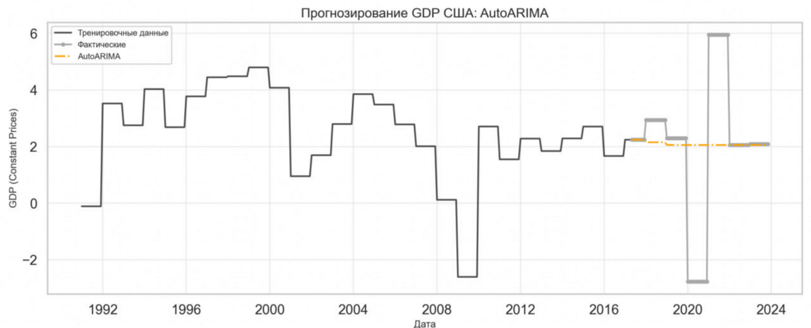
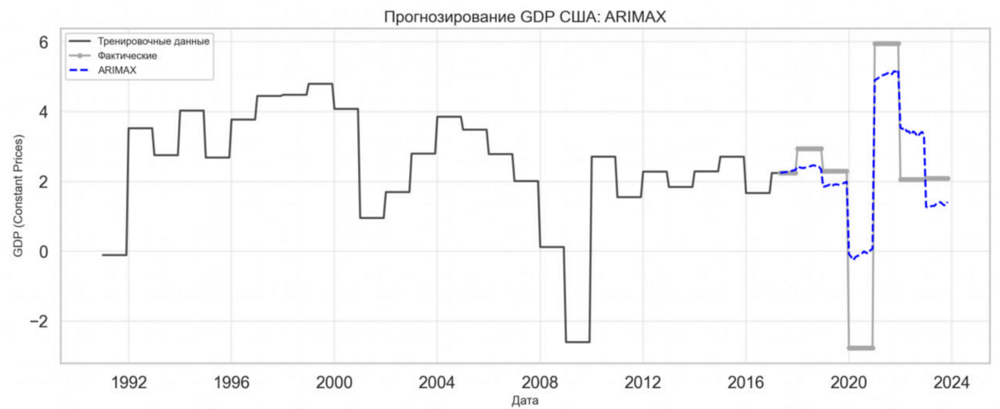
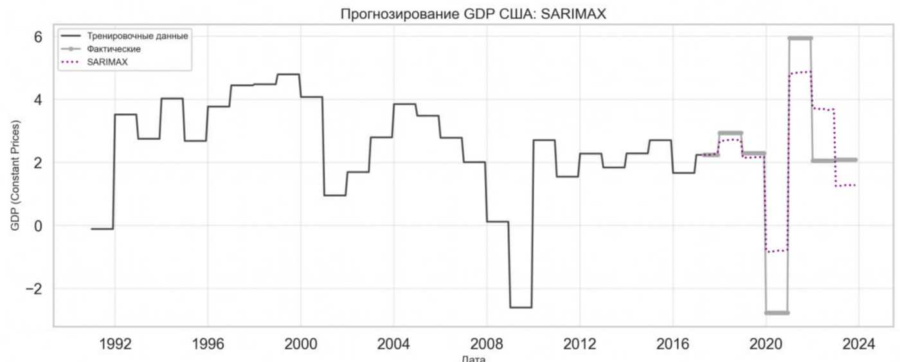

<div align="center">



<br>


</div>

# Семейство ARIMA: прогноз ВВП США на sktime

Экзаменационный проект по курсу «Большие данные и аналитика» (ИТМО). Сравнение семи подходов к прогнозированию месячного ряда ВВП США в постоянных ценах: два наивных базовых прогноза, ARIMA, SARIMA, AutoARIMA, ARIMAX и SARIMAX. Эксперимент оформлен как Python-пакет с CLI, метриками, графиками и тестами.

**📄 [Полный отчёт с литературным обзором (PDF)](./report/arima-family-gdp-forecasting-report.pdf)**

## 🎯 Результат

Тест: 79 месяцев (2017-2023), обучение: 316 месяцев (1991-2017).

| Модель | MAE | RMSE | MAPE, % | R² | Theil's U |
|---|---:|---:|---:|---:|---:|
| Наивный | 1,488 | 2,446 | 43,3 | -0,003 | 2,00 |
| Сезонный наивный | 1,707 | 2,472 | 51,4 | -0,025 | 2,03 |
| ARIMA(1,1,1) | 1,623 | 2,477 | 51,3 | -0,029 | 2,03 |
| SARIMA(0,1,0)(0,0,2,12) | 1,691 | 2,463 | 50,5 | -0,018 | 2,02 |
| AutoARIMA | 1,485 | 2,437 | 42,3 | 0,004 | 2,00 |
| ARIMAX | 0,997 | 1,282 | 37,5 | 0,725 | 1,05 |
| **SARIMAX** | **0,884** | **1,130** | **33,2** | **0,786** | **0,93** |

Модели только по истории самого ряда не лучше наивного прогноза (Theil's U около 2). Модели с внешними переменными снижают RMSE более чем вдвое, и только SARIMAX обходит наивный прогноз по Theil's U (0,93). Полная таблица: [results/metrics_report.csv](./results/metrics_report.csv).

<p align="center">
  
</p>

<details>
<summary><b>Прогнозы отдельных моделей</b></summary>
<br>





</details>

## ⚠️ Как читать эти цифры

Это учебный эксперимент, и у него есть ограничения, которые важно видеть:

- **Целевая переменная это годовой темп роста ВВП, растянутый на месяцы.** На графиках видны ступеньки: значение постоянно внутри года. Поэтому месячная «сезонность» с периодом 12 во многом артефакт интерполяции, а не реальная сезонность.
- **Тест почти целиком определяется ковидом.** Падение 2020 года и отскок 2021 года дают основную часть ошибки, поэтому абсолютные метрики сильно зависят от этих двух лет.
- **У ARIMAX и SARIMAX преимущество «из будущего».** В тесте им подаются фактические значения экзогенных переменных (безработица, инфляция, импорт, экспорт, индекс S&P 500). В реальном прогнозе их пришлось бы тоже прогнозировать, и качество было бы ниже.
- **MAPE и MASE плохо подходят для этого ряда:** значения близки к нулю и отрицательны, а ряд ступенчатый, отсюда MAPE 33-51% и MASE в десятки. Опираться стоит на MAE, RMSE и Theil's U.
- Параметры SARIMA взяты из AutoARIMA, подобранного на обучающей части, поэтому SARIMA и AutoARIMA не независимые эксперименты.
- Таблица выше получена в исходном запуске скрипта. В пакете масштабирование внешних переменных считается только по обучающей части (в исходном скрипте по всему ряду), поэтому при повторном запуске числа могут немного отличаться.

## 🧱 Структура

```text
arima-gdp-forecasting/
├── src/arima_gdp/
│   ├── config.py     # столбцы, доля теста, порядки моделей
│   ├── data.py       # загрузка, регулярный индекс, интерполяция, масштабирование
│   ├── metrics.py    # MAE, RMSE, MAPE, sMAPE, R², Theil's U, MASE
│   ├── models.py     # 7 моделей: sktime (ARIMA, SARIMA, AutoARIMA) и statsmodels (ARIMAX, SARIMAX)
│   ├── plots.py      # графики прогнозов и сравнения
│   └── run.py        # CLI
├── tests/            # pytest на синтетических данных
├── results/          # таблица из отчёта и выходы запуска
├── report/           # отчёт (PDF)
├── assets/           # баннер и графики из отчёта
└── data/             # инструкция по данным
```

## ▶️ Запуск

```bash
cd ml/arima-gdp-forecasting
pip install -e ".[dev,kaggle]"
arima-gdp --download --out results/run        # или: arima-gdp --csv path/to/data.csv
pytest -q
```

Результат запуска: `metrics.csv`, `forecasts.csv` и графики в выбранной папке.

## 🔬 Метод

- **Данные:** 395 месячных наблюдений США, январь 1991 - ноябрь 2023, пропуски линейно интерполируются, внешние переменные стандартизуются.
- **Разбиение:** хронологическое 80/20, без перемешивания.
- **Модели:** ARIMA, SARIMA и AutoARIMA через sktime; ARIMAX и SARIMAX через statsmodels `SARIMAX`, потому что нужны внешние регрессоры.
- **Метрики:** MAE, RMSE, MAPE, sMAPE, R², Theil's U (относительно наивного прогноза), MASE.

## 📚 Что внутри отчёта

История и сравнение моделей семейства ARIMA, роль в аналитике больших данных, критерии сравнения (учитываемые свойства ряда, сложность настройки, вычислительные затраты, интерпретируемость), описание эксперимента и выводы.

[← Машинное обучение](../) · [← Все проекты](../../)
