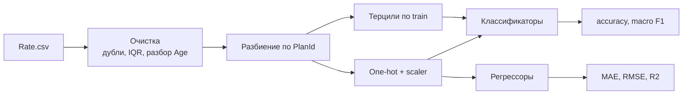

<p align="center"></p>

# Health Insurance Rate Modeling

[](https://github.com/0lake/projects/actions/workflows/ml-insurance-ci.yml)


Классификация и регрессия тарифов на медицинское страхование (US Health Insurance Marketplace) **без утечки целевой переменной**. Проект переписан по мотивам учебной лабораторной, в которой метрики были завышены. Ниже объясняется, что именно было не так и как это исправлено.

## Задачи

| Задача | Цель | Модели |
|---|---|---|
| Классификация | `RateCategory`: Low / Medium / High (терцили `IndividualRate`) | Baseline, Logistic Regression, Random Forest, Voting (LR + RF, soft) |
| Регрессия | `IndividualRate` | Baseline (среднее), Ridge, Random Forest |

Признаки: `StateCode`, `IssuerId`, `RatingAreaId`, `Tobacco`, `BusinessYear`, возраст (числом) и флаг `Family Option`.



## Что было не так в исходной работе

1. **Утечка в классификации.** Класс `RateCategory` получался разбиением `IndividualRate` на терцили, а сам `IndividualRate` оставался среди признаков. Модель просто восстанавливала пороги, отсюда accuracy около 0.99995. Это не качество модели, а признак ошибки в постановке.
2. **Почти копия цели в регрессии.** `IndividualTobaccoRate` это тариф для курящих, то есть тот же тариф с надбавкой. Получившийся R² около 0.77 и RMSE около 137 нельзя считать честной оценкой.
3. **Случайное разбиение строк.** Один и тот же план встречается для десятков возрастов и лет, поэтому похожие строки попадали и в train, и в test.
4. **Потеря строк.** Возрасты вида `0-20`, `64 and over`, `Family Option` не приводились к числу и отбрасывались.

### Что сделано

- `IndividualRate` и `IndividualTobaccoRate` исключены из признаков (проверяется в тестах и `assert` в коде).
- Пороги терцилей считаются **только по train**.
- Разбиение train/test идет **по `PlanId`** (`GroupShuffleSplit`): целые планы не пересекаются.
- Особые возрастные категории разобраны, а не удалены.
- Добавлены baseline и сравнение моделей по macro F1, а не только accuracy.
- Флаг `--with-tobacco-rate` воспроизводит старую постановку регрессии, чтобы можно было сравнить.

## Результаты

Запуск на полном `Rate.csv` здесь не выполнялся (Kaggle недоступен из окружения разработки), поэтому честные цифры будут добавлены после запуска. Тесты на синтетических данных подтверждают, что пайплайн работает и что утечка в тестах дает почти идеальную точность, а честная постановка нет.

| Метрика | Исходная работа | Этот проект |
|---|---|---|
| Classification accuracy | 0.99995 (утечка) | будет добавлено |
| Classification macro F1 | нет | будет добавлено |
| Regression R² | 0.77 (с копией цели) | будет добавлено |
| Regression RMSE | около 137 | будет добавлено |

## Запуск

```bash
pip install -e ".[dev]"
pytest
insurance-rates --csv data/Rate.csv --sample 300000       # честная постановка
insurance-rates --csv data/Rate.csv --with-tobacco-rate   # для сравнения
```

Результаты пишутся в `results/metrics_*.json`, графики в `assets/figures/`.

## Структура

```
src/insurance_rates/   config, data, models, evaluate, run (CLI)
tests/                 синтетические данные, проверка отсутствия утечки
data/                  инструкция по загрузке Rate.csv
results/               метрики запуска
```

## Контакты

Telegram: [@ollogi](https://t.me/ollogi) · [Резюме](https://drive.google.com/drive/folders/1k8JxVXoA4IyDKNency-2qoXDov1iHgMl)
