<div align="center">


<br>

[](https://github.com/0lake/projects/actions/workflows/telco-churn-ci.yml)


**[Результаты](#-результаты)** · **[Быстрый старт](#-быстрый-старт)** · **[Как устроено](#-как-устроено)** · **[Ограничения](#-ограничения)** · **[Журнал исследования](#-журнал-исследования)**

</div>

---

## О проекте

Модель, которая заранее находит клиентов телеком-компании с высоким риском ухода, чтобы им успели предложить скидку, бонус или другой тариф. Удержать клиента дешевле, чем привлечь нового.

Проект это не только модель, а полный цикл: очистка данных, сравнение моделей, выбор порога решения под бизнес-требование, интерпретация, тесты, CLI для обучения и скоринга новых клиентов.

**Бизнес-требование:** найти не менее 80% клиентов, которые собираются уйти, с минимумом ложных тревог.

## Результаты

Отложенная выборка: 1409 клиентов, из них 374 ушли (26,5%). Тест не использовался ни для выбора модели, ни для выбора порога.

| Recall | Precision | ROC-AUC | PR-AUC |
|:---:|:---:|:---:|:---:|
| **0,81** | **0,54** | **0,855** | **0,667** |
| найдено 302 из 374 ушедших | 54% предупреждений верные | качество ранжирования | при базовой доле оттока 0,265 |

**Что это значит на практике.** Если связаться с 40% клиентов, которых модель отметила как рискованных, можно удержать в поле зрения 81% тех, кто собирался уйти. Среди тех, с кем связались, уходящих в 2 раза больше, чем при случайном выборе (54% против 26,5%). Если связываться только с 20% самых рискованных, модель находит половину ушедших.

<p align="center">
  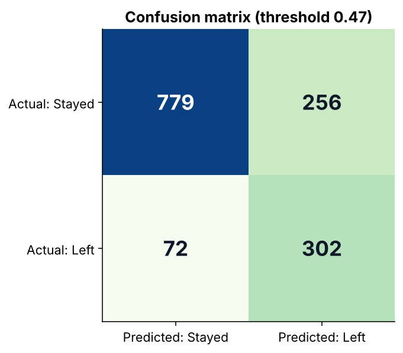
  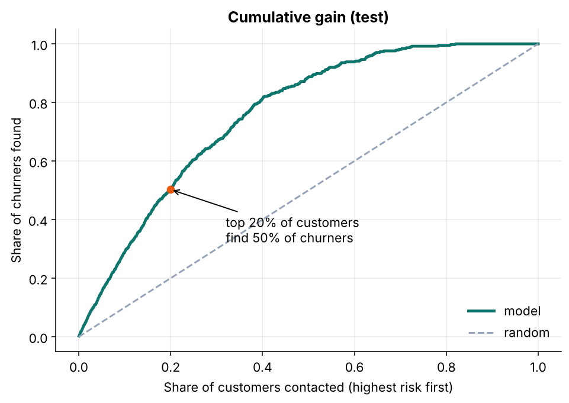
</p>

### Сравнение моделей

Выбор модели делался по PR-AUC на 5-fold кросс-валидации обучающей выборки. Метрики справа посчитаны на тесте при стандартном пороге 0,5.

| Модель | CV PR-AUC | CV ROC-AUC | Test Recall | Test Precision | Test F1 |
|---|---:|---:|---:|---:|---:|
| Константная | 0,265 | 0,500 | 0,000 | 0,000 | 0,000 |
| Logistic Regression | 0,676 | 0,859 | 0,783 | 0,511 | 0,618 |
| Decision Tree | 0,636 | 0,842 | 0,791 | 0,503 | 0,615 |
| **Random Forest** | **0,679** | **0,862** | 0,778 | 0,543 | 0,640 |
| Hist Gradient Boosting | 0,676 | 0,860 | 0,789 | 0,518 | 0,625 |

Победил Random Forest, его гиперпараметры подобраны через `RandomizedSearchCV` (CV PR-AUC вырос до 0,686). Честная оговорка: разница между топ-3 моделями в пределах шума, простая логистическая регрессия почти не уступает. Главный выигрыш дал не выбор алгоритма, а балансировка классов и подбор порога.

<p align="center">
  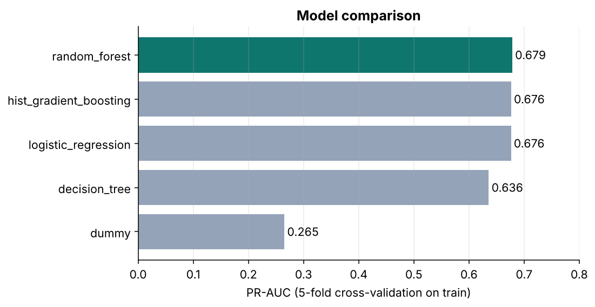
  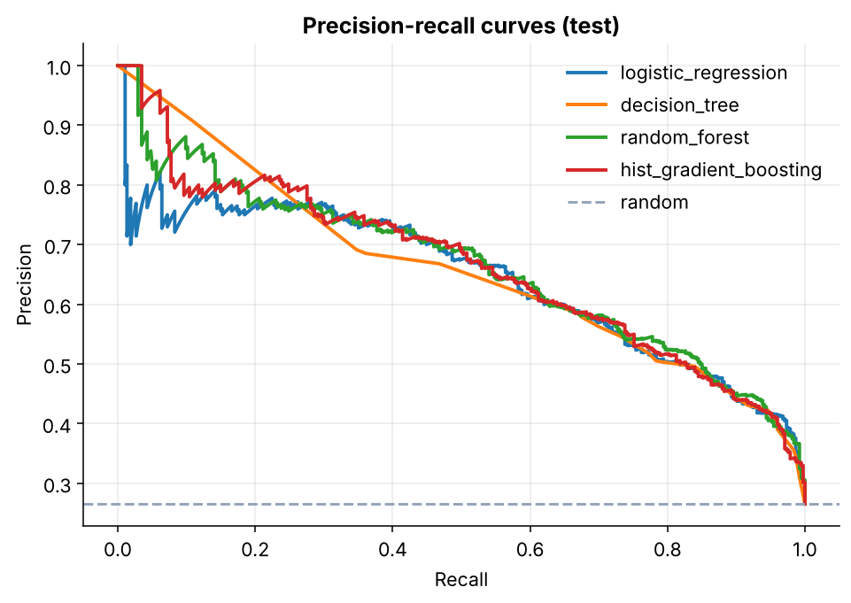
</p>

### Что влияет на отток

Permutation importance и SHAP сходятся: сильнее всего риск повышают помесячный контракт, короткий стаж и оптоволоконный интернет. Защищают долгосрочные контракты, наличие иждивенцев и подключённые защитные услуги.

<p align="center">
  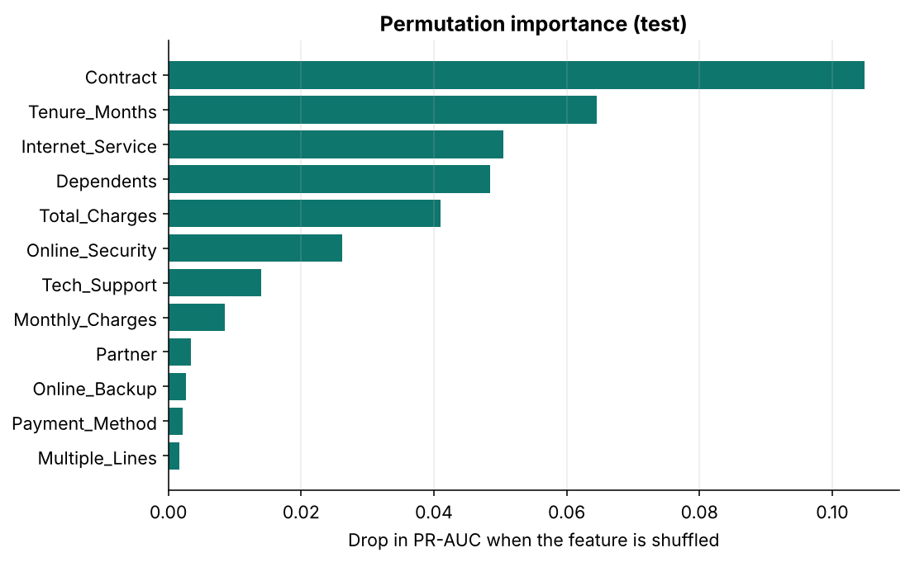
  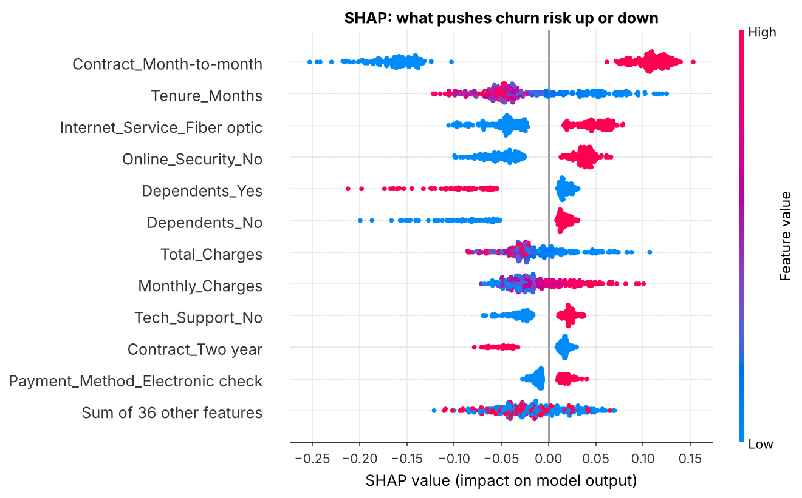
</p>

Разбор клиента с самым высоким риском в выборке SHAP: помесячный контракт, стаж около месяца, оптоволокно, нет онлайн-защиты и техподдержки.

<p align="center">
  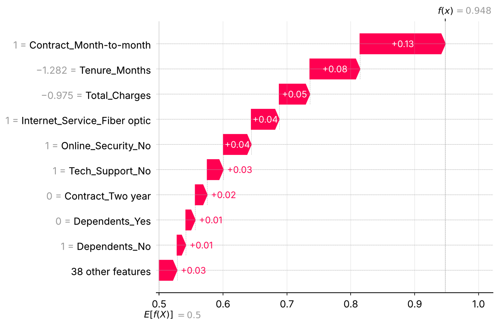
</p>

**Рекомендации для бизнеса:** в первую очередь работать с новыми клиентами на помесячных контрактах, предлагать им переход на долгосрочный тариф, а клиентам с оптоволокном подключать техподдержку и онлайн-защиту.

## Быстрый старт

```bash
git clone https://github.com/0lake/projects.git
cd projects/ml/telco-churn-prediction

python -m venv .venv && source .venv/bin/activate
pip install -e ".[dev]"
```

**1. Данные.** Скачайте [Telco Customer Churn](https://www.kaggle.com/datasets/abdallahwagih/telco-customer-churn) и положите `Telco_customer_churn.xlsx` в папку `data/`.

**2. Обучение** (около 4 минут вместе с подбором гиперпараметров и SHAP):

```bash
python -m churn.train
# быстрый прогон без подбора и объяснений:
python -m churn.train --no-tune --no-explain
```

Результаты появятся в `reports/` (метрики, таблица сравнения, графики), модель в `models/churn_model.joblib`.

**3. Скоринг новых клиентов:**

```bash
python -m churn.predict --input new_customers.xlsx --output scored.csv
```

На выходе файл, отсортированный по риску: `CustomerID`, `churn_risk_score`, `retention_flag`.

**4. Тесты** (работают офлайн на синтетических данных):

```bash
pytest
```

## Как это устроено

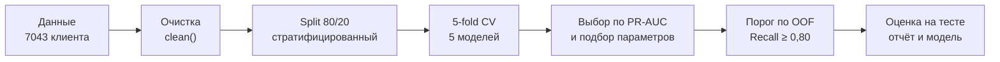

- **Единое разбиение.** Стратифицированное 80/20 с фиксированным `random_state`, тест не трогается до финальной оценки.
- **Без утечек.** Из признаков исключены `Churn_Label`, `Churn_Value`, `Churn_Score` (готовый скор риска из датасета) и `Churn_Reason` (известна только ушедшим). Масштабирование и кодирование находятся внутри пайплайна и обучаются только на train-фолдах.
- **Метрика выбора модели.** PR-AUC устойчива к дисбалансу классов и не зависит от порога. Accuracy для этой задачи вводит в заблуждение: константная модель даёт 73,5%, но не находит ни одного ушедшего.
- **Порог решения.** Выбирается на out-of-fold предсказаниях как самый высокий порог, при котором Recall не ниже целевого. Это удерживает число ложных тревог минимальным при выполнении бизнес-требования. Целевой Recall меняется параметром `--target-recall`.
- **Скор, а не вероятность.** Из-за балансировки классов выход модели не является откалиброванной вероятностью, поэтому колонка называется `churn_risk_score`.

## Структура проекта

```text
telco-churn-prediction/
├── src/churn/
│   ├── config.py        # пути, seed, списки признаков
│   ├── data.py          # загрузка, очистка, разбиение
│   ├── features.py      # препроцессинг (внутри пайплайна)
│   ├── models.py        # кандидаты и пространства поиска
│   ├── evaluate.py      # метрики и выбор порога
│   ├── plots.py         # графики отчёта
│   ├── explain.py       # permutation importance и SHAP
│   ├── train.py         # CLI обучения
│   └── predict.py       # CLI скоринга
├── tests/               # 15 тестов на синтетических данных
├── reports/             # метрики, сравнение моделей, графики
├── notebooks/           # журнал исследования: EDA, бейзлайны, лес и SHAP
├── data/                # сюда кладётся датасет (не в репозитории)
├── pyproject.toml
├── Makefile
└── README.md
```

## Ограничения

- **Датасет учебный.** Это учебный пример IBM по вымышленной компании. Выводы показывают подход, а не реальное поведение клиентов.
- **Один срез во времени.** Нет временной динамики, поэтому проверка сделана случайным, а не временным разбиением. В реальности модель нужно проверять на более поздних периодах.
- **Нет данных о деньгах.** Порог выбран под целевой Recall, а не под прибыль. Для оптимума нужны стоимость предложения по удержанию и ценность клиента.
- **`CLTV` в признаках.** Это готовый показатель из датасета. В реальной системе нужно проверить, что он считается без знания будущего оттока.
- **Различия моделей малы.** Топ-3 модели статистически близки, оценка по одному разбиению имеет разброс порядка нескольких пунктов.

## Что дальше

- Откалибровать вероятности (изотоническая регрессия) и проверить калибровку.
- Подобрать порог по ожидаемой прибыли при заданных стоимости удержания и ценности клиента.
- Добавить повторную кросс-валидацию и доверительные интервалы метрик.
- Попробовать CatBoost и XGBoost, использовать геопризнаки через кластеризацию.

## Журнал исследования

Ноутбуки показывают, как проект рос от разведки данных к итоговому пайплайну.

| Ноутбук | Что внутри |
|---|---|
| [`01-eda-churn.ipynb`](notebooks/01-eda-churn.ipynb) | Разведочный анализ: баланс классов, категориальные и числовые признаки, корреляции, PCA |
| [`02-baseline-models.ipynb`](notebooks/02-baseline-models.ipynb) | Бейзлайны: константная модель, логистическая регрессия, дерево решений, KNN |
| [`03-random-forest-shap.ipynb`](notebooks/03-random-forest-shap.ipynb) | Первая версия леса, permutation importance и SHAP |

В первой версии леса (ноутбук 03) Recall был всего 0,50. Причина в том, что лес обучался без балансировки классов и на другом разбиении, чем бейзлайны. В итоговом пайплайне это исправлено.

<p align="center">
  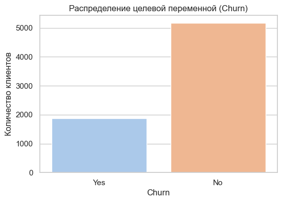
  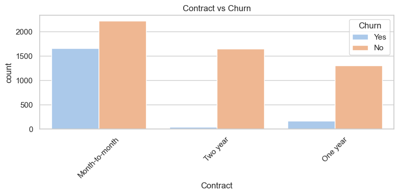
  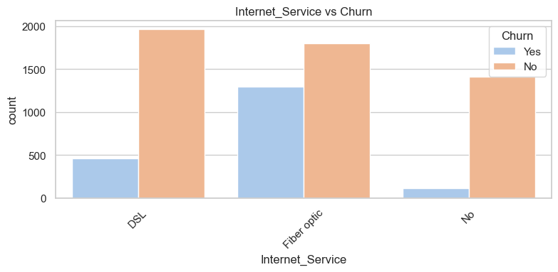
</p>

Из EDA: при помесячной оплате уходит около 43% клиентов (при долгосрочных 3-11%), при оптоволокне около 42%, пожилые клиенты уходят чаще (41,7% против 23,6%).

---

<div align="center">

Олег Садовников · [Telegram](https://t.me/ollogi) · [Резюме](https://drive.google.com/drive/folders/1k8JxVXoA4IyDKNency-2qoXDov1iHgMl) · [Все проекты](../../)

</div>
