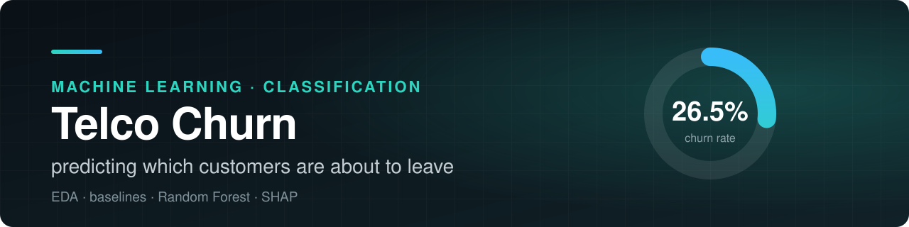
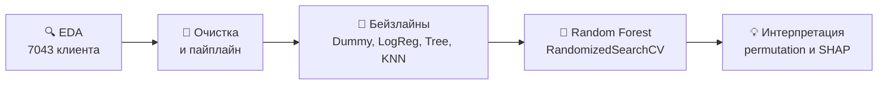
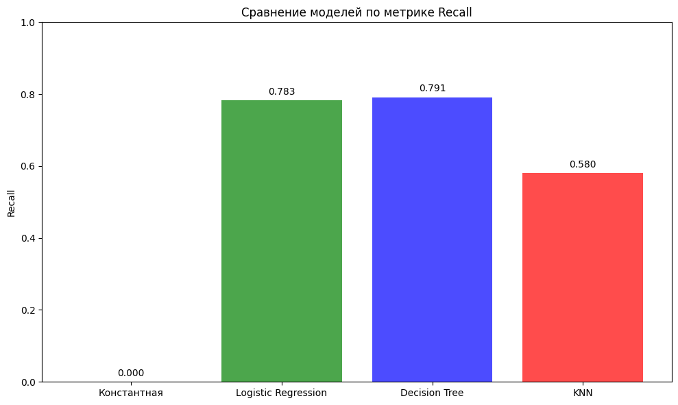
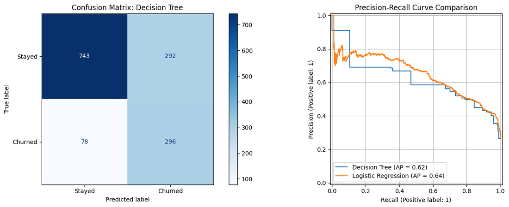
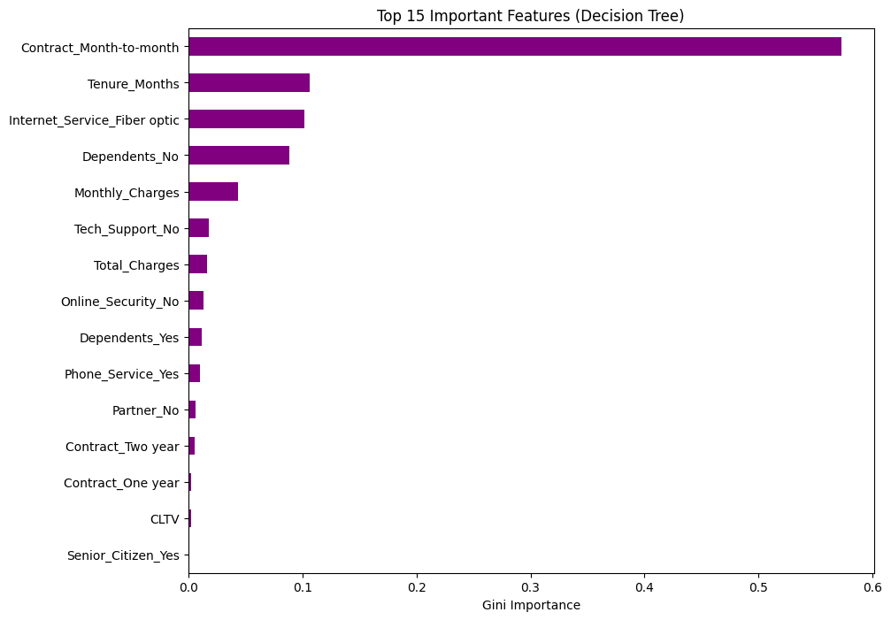
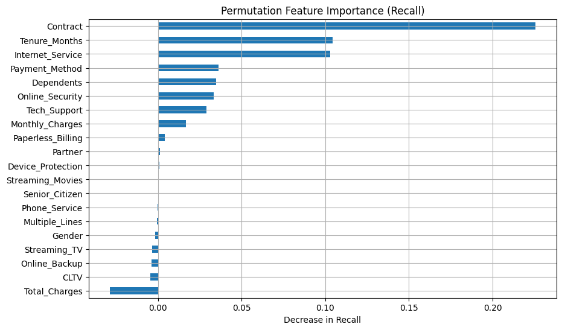
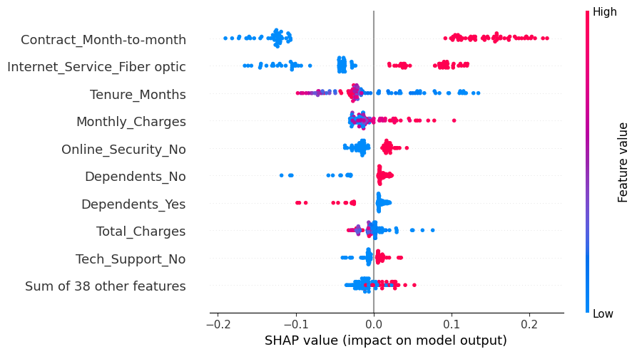
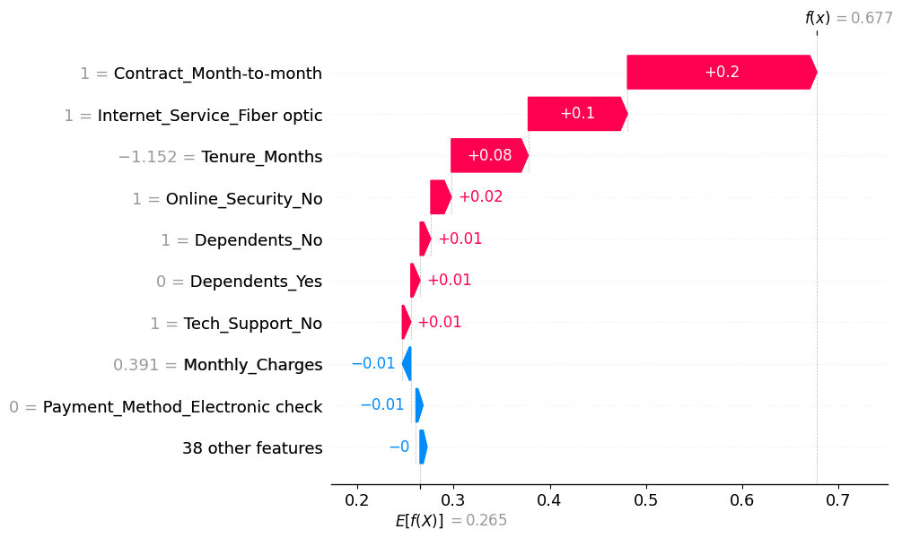

<div align="center">



<br>


**[🔍 EDA](notebooks/01-eda-churn.ipynb)** · **[📏 Бейзлайны](notebooks/02-baseline-models.ipynb)** · **[🌲 Random Forest и SHAP](notebooks/03-random-forest-shap.ipynb)** · **[📦 Датасет](https://www.kaggle.com/datasets/abdallahwagih/telco-customer-churn)**

</div>

---

## 🎯 Задача

Телеком-компании дешевле удержать клиента, чем привлечь нового. Нужен детектор ухода: модель, которая заранее находит клиентов с высоким риском оттока, чтобы предложить им скидку, бонус или другой тариф.

- **Тип задачи:** бинарная классификация (`Churn`: 1 уйдёт, 0 останется).
- **Данные:** [Telco Customer Churn](https://www.kaggle.com/datasets/abdallahwagih/telco-customer-churn), 7043 клиента, 33 признака: демография, подключённые услуги, платежи.
- **Дисбаланс:** ушли 26,5% клиентов (1869 из 7043).
- **Главная метрика:** Recall. Пропустить уходящего клиента (FN) дороже, чем лишний раз предложить удержание (FP). Дополнительно F1-score и Accuracy.

## 🧭 Как шла работа



## 🔍 Что показал EDA

<p align="center">
  
  
  
</p>

- **Тип контракта.** При помесячной оплате уходит около 43% клиентов, при долгосрочных контрактах 3-11%.
- **Интернет.** Fiber optic: отток около 42%. У клиентов с DSL и без интернета он заметно ниже.
- **Допуслуги.** Tech Support, Online Backup и Device Protection повышают лояльность.
- **Демография.** Пожилые клиенты уходят чаще (41,7% против 23,6%), как и клиенты без партнёра или детей.
- **Числовые признаки.** Стаж (`Tenure_Months`) отрицательно коррелирует с оттоком (-0,35), ежемесячный платёж связан с ним положительно (0,19).

## 📏 Бейзлайны

Выборка разбита стратифицированно в пропорции 80/20: 5634 клиента в train и 1409 в test.

| Модель | Recall | F1-score | Accuracy |
|---|---:|---:|---:|
| Константная (всегда «останется») | 0,0000 | 0,0000 | 0,7346 |
| Logistic Regression | 0,7834 | 0,6181 | 0,7431 |
| **Decision Tree** (`max_depth=5`, `class_weight='balanced'`) | **0,7914** | 0,6154 | 0,7374 |
| KNN (k=11) | 0,5802 | 0,5794 | 0,7764 |

<p align="center">
  
  
</p>

Константная модель даёт Accuracy 73%, но не находит ни одного уходящего клиента: это показывает, почему при дисбалансе нельзя смотреть только на Accuracy. Лучший Recall у дерева решений: оно нашло 296 из 374 уходящих клиентов (78 пропущено), ценой 292 ложных тревог.

<p align="center">
  
</p>

## 🌲 Random Forest и интерпретация

Подбор гиперпараметров: `RandomizedSearchCV`, 20 комбинаций, 5-fold, оптимизация по Recall.

| Параметр | Значение |
|---|---|
| `n_estimators` | 500 |
| `max_depth` | 5 |
| `min_samples_split` | 2 |
| `min_samples_leaf` | 2 |
| `max_features` | `None` |

| | Recall | F1-score | Accuracy |
|---|---:|---:|---:|
| CV (5-fold) | 0,5478 | | |
| Test | 0,4968 | 0,5672 | 0,7990 |

**Честный итог:** лес нашёл только около половины уходящих клиентов, это хуже бейзлайнов из прошлого этапа. Причина видна в коде: лес обучался без балансировки классов, а логистическая регрессия и дерево решений с `class_weight='balanced'`. Высокая Accuracy (0,799) здесь обманчива из-за дисбаланса. По главной метрике лучшей остаётся модель из второго этапа.

### Что влияет на отток

Permutation importance и SHAP сходятся в одном: решает тип контракта.

<p align="center">
  
  
</p>

Разбор отдельного клиента через SHAP: для клиента с помесячным контрактом, оптоволокном и коротким стажем модель даёт риск 0,677 при базовом уровне 0,265. Больше всего риск повышают помесячный контракт (+0,20), оптоволокно (+0,10) и короткий стаж (+0,08).

<p align="center">
  
</p>

## 💼 Выводы для бизнеса

- Главная группа риска: клиенты на помесячном контракте, с оптоволоконным интернетом, коротким стажем и без допуслуг (техподдержка, онлайн-защита). Их стоит переводить на долгосрочные контракты и подключать допуслуги.
- Для задачи удержания важнее полнота, чем точность, поэтому модель нужно выбирать и настраивать по Recall.

## 🔭 Что можно улучшить

- Добавить `class_weight='balanced'` в лес и подобрать порог классификации по Precision-Recall кривой.
- Попробовать градиентный бустинг (CatBoost, XGBoost), как рекомендовано в выводах EDA.
- Использовать геоданные (`Zip_Code`, координаты) через кластеризацию или target encoding.
- Оценить экономику: стоимость удержания против потери клиента, чтобы выбрать порог по прибыли.

## 🔁 Как воспроизвести

<details>
<summary><b>Запуск ноутбуков</b></summary>

<br>

1. Скачайте [Telco Customer Churn](https://www.kaggle.com/datasets/abdallahwagih/telco-customer-churn) и положите файл `Telco_customer_churn.xlsx` в папку [`data`](data).
2. Установите зависимости и запустите Jupyter:

```bash
python -m venv .venv && source .venv/bin/activate
pip install -r requirements.txt
jupyter lab
```

3. Запускайте ноутбуки по порядку из папки `notebooks`: `01`, `02`, `03`.

Сам датасет в репозиторий не включён.

</details>

## 🗂 Структура

```text
telco-churn-prediction/
├── notebooks/
│   ├── 01-eda-churn.ipynb
│   ├── 02-baseline-models.ipynb
│   └── 03-random-forest-shap.ipynb
├── data/             # сюда кладётся датасет
├── assets/           # баннер и графики для README
├── requirements.txt
└── README.md
```

---

<div align="center">

Олег Садовников · [Telegram](https://t.me/ollogi) · [Резюме](https://drive.google.com/drive/folders/1k8JxVXoA4IyDKNency-2qoXDov1iHgMl) · [Все проекты](../../)

</div>
