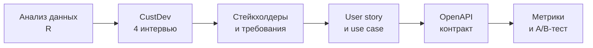
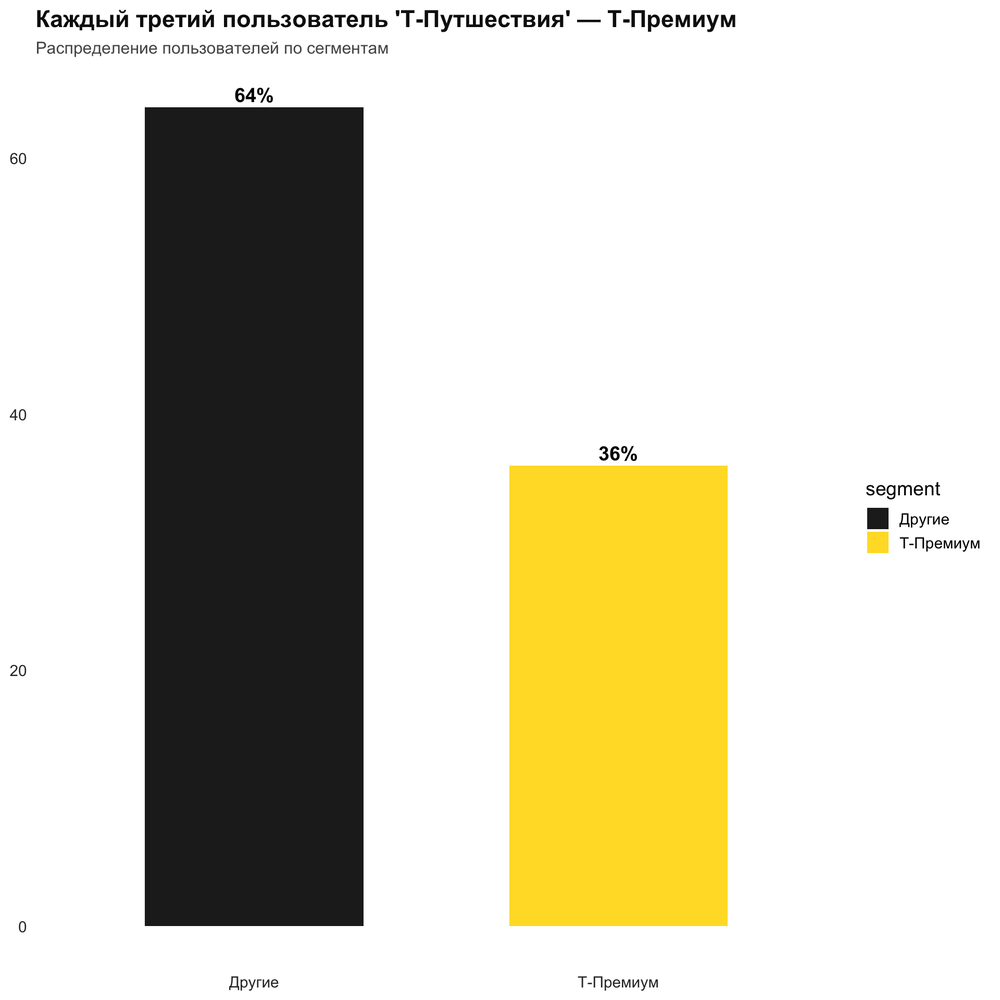
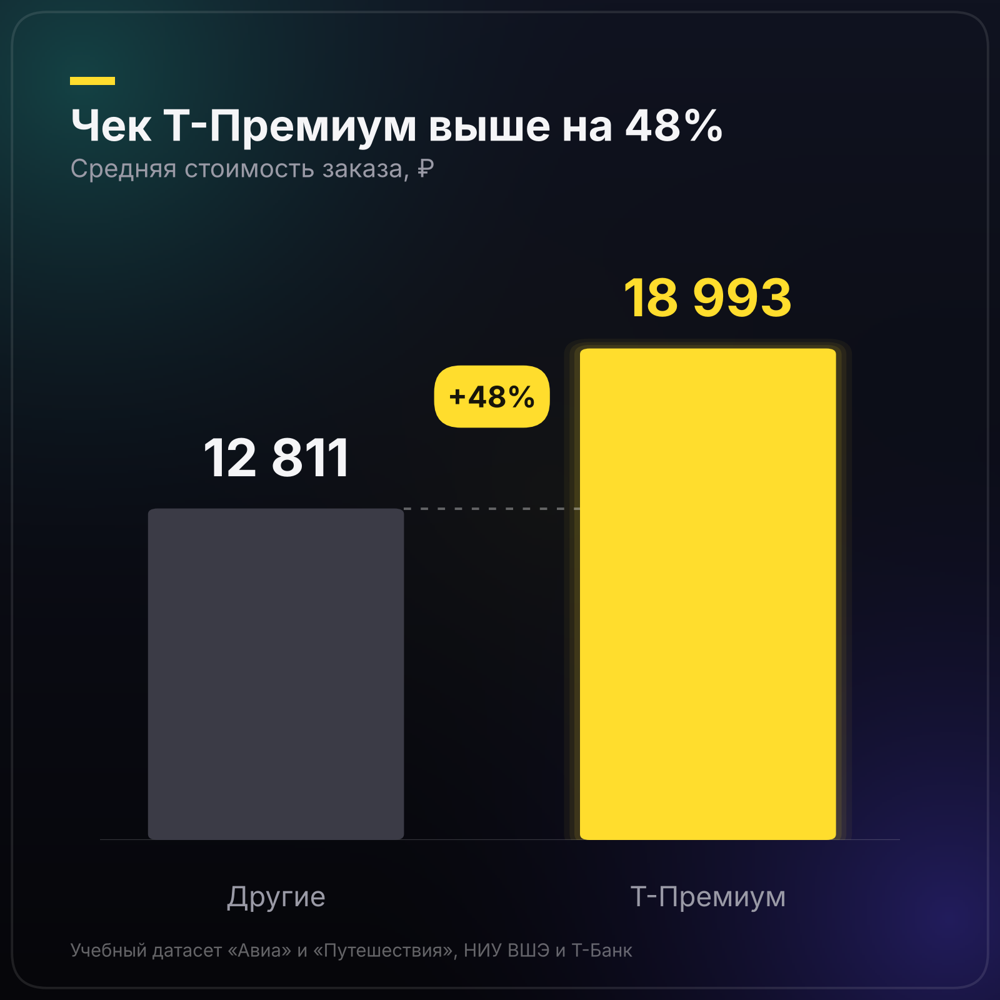
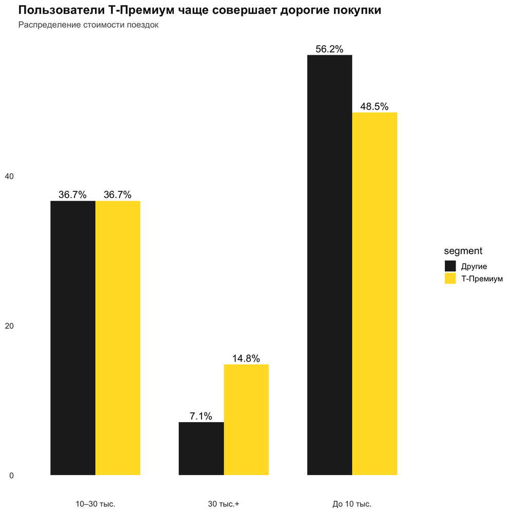
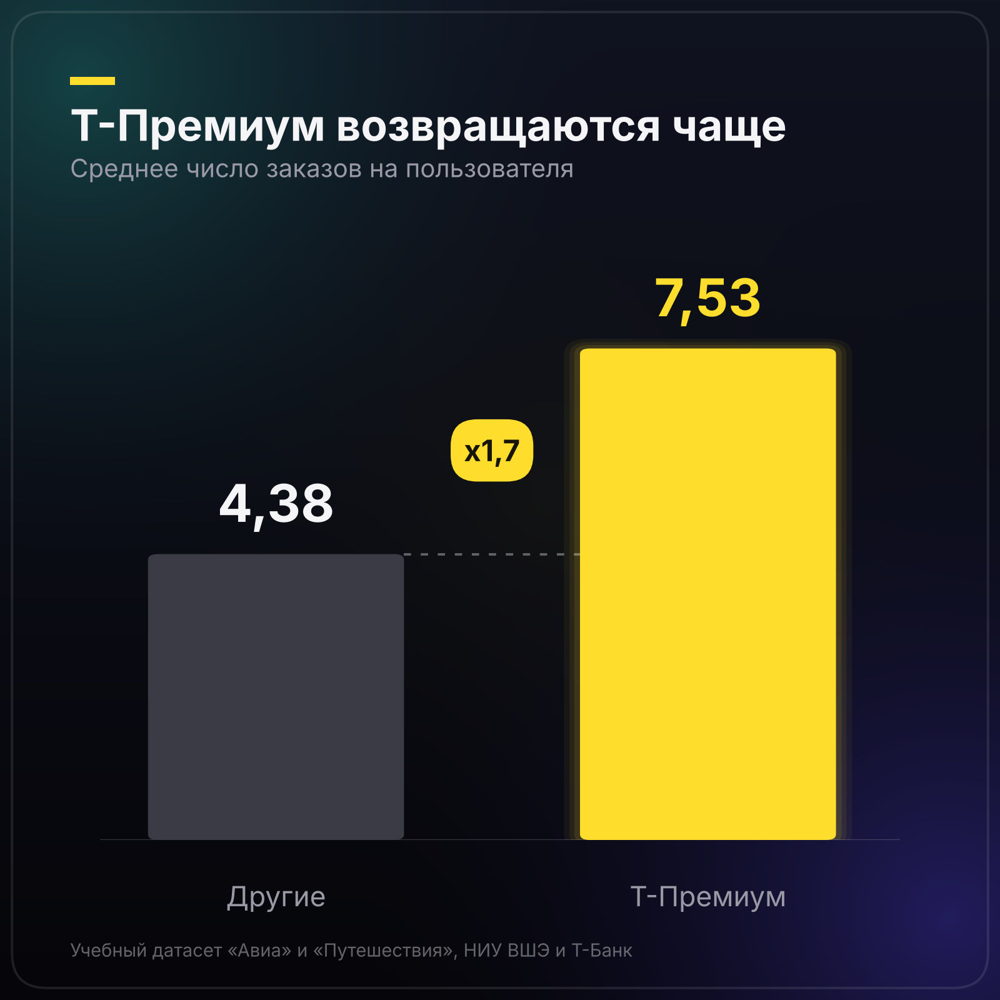
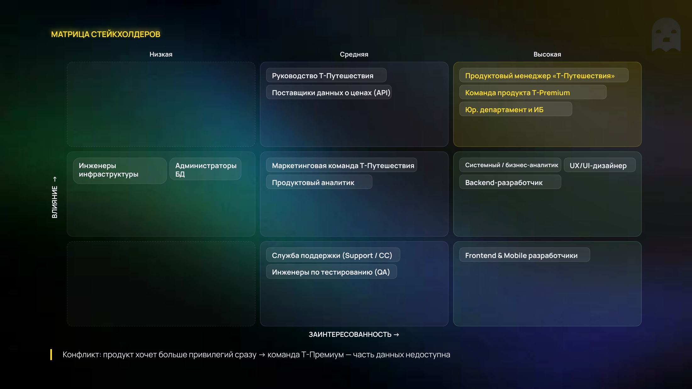

<div align="center">


<br>


**[PRD](docs/01-prd-price-tracker-tpremium.pdf)** · **[Презентация](docs/02-presentation-price-tracker-tpremium.pdf)** · **[API](api/openapi-t-travel-price-tracker.yaml)** · **[Отчёт](https://htmlpreview.github.io/?https://github.com/0lake/projects/blob/main/tbank-intensive/analysis/hypothesis-check-tpremium.html)**

</div>

---

## Идея

В трекере цен «Т-Путешествий» решение о покупке принимается только по цене. Привилегии Т-Премиум (проходы в бизнес-залы, кешбэк, страховка) живут в другом разделе приложения. Из-за этого клиент выбирает менее выгодный рейс или не успевает воспользоваться уже оплаченной привилегией.

**Фича:** опция «Учитывать привилегии Т-Премиума» в подписке на отслеживание. Сервис анализирует остаток проходов в бизнес-залы и дату их обновления, а уведомление объясняет общую выгоду поездки, а не только цену.

> Пример из презентации: билет дороже на 700 ₽, но дата совпадает с обновлением прохода, поэтому он рекомендуется как более выгодный.

## Как шла работа



## Что показали данные

Учебные датасеты «Авиа» и «Путешествия» (НИУ ВШЭ и Т-Банк, олимпиада DANO).

| Показатель | Другие | Т-Премиум |
|---|---:|---:|
| Доля аудитории | 64% | **36%** |
| Средний чек | 12 811 ₽ | **18 993 ₽** (+48%) |
| Заказов на пользователя | 4,38 | **7,53** |
| Доля поездок дороже 30 тыс. ₽ | 7,1% | **14,8%** |

<p align="center">
  
  
</p>
<p align="center">
  
  
</p>

Вывод: это треть аудитории, которая летает чаще и тратит больше остальных. Для неё важна не только цена, но и комфорт поездки.

## CustDev

Проведено 4 глубинных интервью с разными профилями: активный travel-пользователь Т-Премиум, владелец подписки с небольшим опытом использования привилегий, пользователь без Т-Премиум и потенциальный клиент. Выводы проверены на открытых отзывах (otzovik, irecommend).

**Гипотеза подтвердилась частично.** У активных путешественников привилегии влияют на выбор рейса, у редко летающих остаются бонусом.

Ключевые инсайты:
- информация о привилегиях живёт отдельно от выбора билета;
- ценность привилегий зависит от частоты поездок;
- не хватает прозрачности при сравнении вариантов;
- нужно понятное объяснение выгоды, а не список бонусов.

## Стейкхолдеры

<p align="center">
  
</p>

## Метрики и A/B-тест

| Тип | Метрика |
|---|---|
| Целевая | Конверсия из просмотра рекомендации в покупку среди пользователей Т-Премиум |
| Guardrail | Доля возвратов и отмен, обращения в поддержку по привилегиям, средний чек |
| Прокси | Open Rate и CTR уведомлений, доля открывших детализацию привилегий, медианное время до покупки |

**Группа A** получает рекомендацию только по цене. **Группа B** получает рекомендацию с учётом привилегий, опция включена по умолчанию, чтобы не смещать выборку самоотбором.

Решение: запускаем при значимом росте целевой метрики (p-value < 0,05), эффекте не меньше MDE и отсутствии значимого ухудшения guardrail-метрик.

## Что в репозитории

| Файл | Что внутри |
|---|---|
| [`docs/01-prd-price-tracker-tpremium.pdf`](docs/01-prd-price-tracker-tpremium.pdf) | PRD: проблема, аудитория, стейкхолдеры, CustDev, требования, use case, критерии приёмки, метрики, A/B |
| [`docs/02-presentation-price-tracker-tpremium.pdf`](docs/02-presentation-price-tracker-tpremium.pdf) | Презентация проекта, 16 слайдов |
| [`docs/03-intensive-workbook-days-1-9.pdf`](docs/03-intensive-workbook-days-1-9.pdf) | Рабочая тетрадь интенсива: паспорт продукта, стейкхолдеры, CustDev, бизнес-процессы, требования, формулировка проблемы, метрики и A/B-тесты |
| [`api/openapi-t-travel-price-tracker.yaml`](api/openapi-t-travel-price-tracker.yaml) | Спецификация T-Travel Price Tracker API: пользователи, подписки, варианты перелётов, уведомления |
| [`analysis/hypothesis_check_tpremium.R`](analysis/hypothesis_check_tpremium.R) | R-скрипт анализа |
| [`analysis/hypothesis-check-tpremium.html`](analysis/hypothesis-check-tpremium.html) | Отчёт R Markdown с кодом и графиками |

Дополнительные материалы к презентации: [Google Drive](https://drive.google.com/drive/folders/1ThvW3iQJFsg4zrmpTC5gHPuur2wyKj8d?usp=sharing).

<details>
<summary><b>Как воспроизвести анализ</b></summary>

<br>

1. Скачайте учебные датасеты «Авиа» и «Путешествия» (олимпиада DANO, НИУ ВШЭ и Т-Банк) и положите в [`analysis/data`](analysis/data):
   - `dano_dataset_travel.csv`
   - `dano_dataset_avia_hashed_corrected_s-2.xlsx`
2. Установите пакеты и запустите скрипт из папки `analysis`:

```r
install.packages(c("readr", "readxl", "dplyr", "tidyr", "ggplot2", "scales"))
source("hypothesis_check_tpremium.R")
```

Сами датасеты в репозиторий не включены.

</details>

<details>
<summary><b>Ограничения</b></summary>

<br>

- Расчёты построены на учебном датасете, а не на внутренних данных продукта, поэтому цифры дают общее представление о поведении пользователей.
- 4 интервью достаточно, чтобы зафиксировать боль, но не чтобы оценить размер сегмента, готового включить опцию.
- В MVP учитываются только проходы в бизнес-залы, без расчёта выгоды в рублях.

</details>

## Структура

```text
tbank-intensive/
├── docs/        # PRD, презентация, рабочая тетрадь
├── api/         # OpenAPI-спецификация
├── analysis/    # R-скрипт, отчёт, папка для данных
├── assets/      # баннер, графики, слайды
└── README.md
```

---

<div align="center">

Олег Садовников · [Telegram](https://t.me/ollogi) · [Резюме](https://drive.google.com/drive/folders/1k8JxVXoA4IyDKNency-2qoXDov1iHgMl) · [Все проекты](../)

</div>
